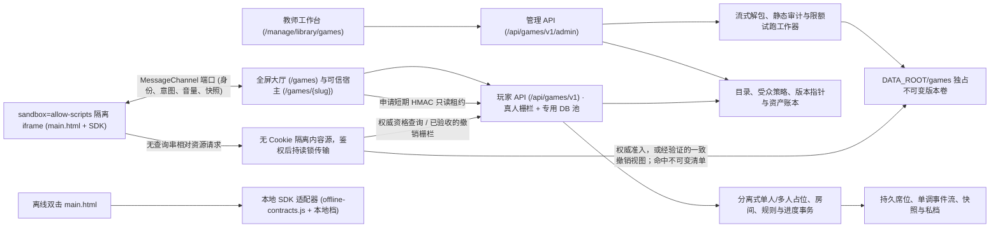

# LanShare HTML 小游戏平台设计方案

**版本**　设计稿 v2.1（v2 改进复核，补齐后端事务与端到端流程） · 2026-11-23

**交给 AI 开发游戏**　师生可在小游戏管理或「我的作品」在线阅读规范、下载 Markdown 或完整开发包。建议将开发包 ZIP 和玩法需求一起交给 AI。包内包含当前校验器、SDK、四份 Schema 和三个独立示例。[AI 小游戏开发规范](ai-author-spec.md)

**作品库和版本**　小游戏大厅的「我的作品」通往学生工作区；教师从教学资源进入小游戏管理。导入时由服务器读取包内名称、作品标识、内容类型和版本号。上传者填写风格标签并决定本版是否开放二次开发。每个作品文件夹按版本号由新到旧排列；改编作品另用标识，公开原版信息用于核对原作者及标签。大厅可临时组合筛选类型和标签，也可确认保存为账户喜好。

**审核与作品管理**　学生和教师可上传、试玩和管理自己的版本。每份新版本通过技术校验后由超管终审；AI 查验报告供超管参考。超管可以管理全部作品并查看各类受众范围内的游戏。已上架版本继续服务。公开源码依该版本的二次开发许可提供，作者和超管也可在管理页下载原包。

**课堂小游戏设置**　教师可从小游戏大厅设置或课堂页选择跟随课表、临时放行或临时禁止。规则仅对所选课堂的学生生效，包含合班学生。默认作用于全部游戏，也可搜索并选择多款，时长为 1–240 分钟。临时规则到期后恢复课表；同一学生同时命中多个课堂的临时规则时，禁止优先。北京时间逐节判断上课范围，课间及课后开放。

**游玩时长与修为**　大厅展示学生当天的前台游玩时长。按北京时间，07:00 至 22:00 的首小时计入奖励，第二小时持平，超过两小时计入扣分。夜间时长始终计入扣分，并占用当天游玩额度。奖励与扣分分别累计，每满一小时各结算一分，尾数可跨天延续。多个游戏或窗口的重叠时间只算一次，后台标签页停止计时。

## 1. 从一次真实游玩看全平台

老师上传《航标接力》ZIP 包，在隔离沙盒预览一局，勾选受众“计科 2401 班、修为 0–6”并提交超管终审。审核通过并上架后，符合条件的学生在顶栏“观点与交流”（博客入口）右侧点击**小游戏**，进入全视口液态玻璃大厅。页面首屏由服务端直出，并为封面预留尺寸（正式构建验收目标为首屏 CLS 0.00），指针掠过卡片时，柔和的合成层背光在圆角方标背后自然跟随。

小林点开《航标接力》，新标签页直接进入沉浸式游戏宿主并恢复上次关卡；在另一标签页随手打开另一款单人拼图也不会互相抢占报错。想和同学合作时，小林在宿主顶栏点“创建队伍”，从允许的 2–4 人中选定 2 人，屏幕展示剔除易混字符（无 `0/O/1/I/L`）的四位大写邀请码。阿岚在同款游戏点“加入队伍”，粘贴或输入小写码均可入座。满员瞬间，两台设备基于同一服务端时钟显示 5 秒弹簧动效倒计时，预告全队将从两人较远的共同里程碑“海角”起航（低进度成员同时看到本人共同关卡推进提示；若想重温早期章节，也可在开局前显式选择已解锁章节而不降低历史最高进度）。倒计时归零，小林的纸色海图和阿岚的夜色海图各自保留，静音开关可由宿主顶栏一键控制。

同一游戏包也可开放固定人数的随机匹配。作者或超管下架游戏后，在途租约与房间立即终止，已确认存档保留；有管理权限的作者或超管执行“彻底删除”时，系统生成影响快照并二次校验游戏标识，按独占资产账本清理全部版本字节、缩略图、队聊与玩家进度后出具回执。浏览器后台节流、断网重连、跨端换号、版本升级或工作器重启均有确定性的恢复路径。

| 模块与交付物 | 实施规格 |
|---|---|
| 全局导航锚点、全屏大厅网格、光学背光、液态玻璃材质层级、沉浸宿主舞台、教师工作台与前端性能预算 | [02 · 页面、交互美学与前端性能规范](02-interface-and-management.md) |
| 真人鉴权栅栏、单人/多人分离占位、无歧义房码、匹配、合并租约、增量流、规则引擎与共同进度重玩 | [03 · 运行时、并发保护与数据合同](03-runtime-and-data.md) |
| 教师管理 API、流式 ZIP 验收、受限浏览器试跑、HMAC 租约与隔离内容网关、版本演进与彻底删除 | [04 · 游戏包管理、内容网关与运维](04-package-operations.md) |
| 独立双环境目录、主清单与展示提示、无源沙盒握手、SDK v1、音频/画布规范、回写契约与正反验收用例 | [05 · 游戏作者手册与 SDK v1](05-game-author-guide.md) |
| 供校验器与打包工具读取的 JSON Schema（Draft 2020-12） | [主清单](contracts/config.schema.json) · [存档契约](contracts/writeback.schema.json) · [统一规则入口](contracts/rules.schema.json) · [棋盘规则子集](contracts/grid-rules.schema.json) |
| 供开发者比对与单元测试直接加载的联调样例 | [航标接力清单](example/config.json) · [三里程碑存档](example/contracts/writeback.json) · [四人可达航标规则](example/contracts/rules.json) |

## 2. 平台组成、部署拓扑与所有权边界

| 边界 | 拟实施模块 | 关键架构与性能约束 |
|---|---|---|
| 页面壳与液态玻璃前端 | Jinja 直出首屏 HTML；按路由拆分为 `games_hall.js`、`games_host.js`、`manage_games.js` 三个按需控制器；页面布局样式落于 `static/css/lq/pages/games.css`。 | **零首屏核心膨胀**：严守 `npm run check:lq-size` 18 KiB gzip 同步入口红线（新增同步字节为 0）。卡片为原生 `<a>`；大厅不预挂 iframe；指针背光纯 `transform: translate3d` 合成层驱动；全屏宿主关闭全局悬浮 AI 挂件与回到顶部按钮。 |
| 真人身份与范围策略 | 基于 `dependencies.py` 新增 `require_human_game_actor` 依赖，显式拦截 `wanderer`（散修）、`agent_broker` 及非 Web 通道；组合 `resource_access_service`、`offering_membership_service`、`student_global_tier` 与 `social_relations`。 | 目录、侧栏、详情、缩略图、内容租约、建队、动作与存档统一走同一服务端授权函数与批量 SQL 投影，严禁逐卡/逐好友 N+1 查库。 |
| 游戏目录与教师工作台 | 独立的游戏、不可变版本、可见范围、标签、操作审计与彻底删除计划模型；沿用 `manage/layout.html` 与 `MANAGE_LIBRARY_DOMAIN` 注册表。 | 游戏脚本永不进入平台 Jinja 模板或主站 `/static`。每个游戏仅有一个 `current_version_id` 发布指针；资产按游戏与版本物理独占，不与全站 `sha256` 共享池耦合。 |
| 房间、同步与主机并发保护 | 小游戏服务持有匹配桶、无歧义四位码、多人全局单占位、单人按游戏占位、服务端时钟、内置确定性引擎与事件序列。数据库工作由有界的游戏执行队列调度；每次作业至多借用一个连接，鉴权、后台协调和导入/清理的短事务均计入预算。 | 目标环境为 2c/4G、主应用池上限 12。游戏新增数据库占用预算为整套部署合计 ≤4，实施时在所有进程间分配额度或统一入队；线程数仅约束本进程，其他业务也共享剩余容量。等待不持连接，续租按 15 秒聚合，游标通知和进程重启后均以持久数据恢复。 |
| 隔离内容源与验收工作器 | 首选独立可注册域 HTTPS 内容站。单备案/内网模式要求独立 HTTPS 主机名、Host-Only 主站及续登 Cookie、独立虚拟主机剥离凭据和强制沙盒响应头，并通过真实浏览器自检。仅换端口的部署不符合条件。 | 包内相对文件共用稳定的随机租约路径，短期 HMAC 凭证在服务端续签。正确性基线是权威鉴权后由 Nginx internal 投递字节；覆盖所有撤权来源、跨进程提交屏障及掉线演练后，才可使用无逐文件查库的快速路径。两种模式均验收 206、最终响应头和缓存。 |
| 作者工具包与内置引擎 | 发行固定摘要 `lan-game-sdk.v1.js`、`offline-contracts.js` 打包器、本地校验 CLI 与三套标准样板包（纯单人、合作《航标接力》、双人棋盘）。 | 联网与双击离线共用同一份游戏业务代码。服务端仅运行经代码注册的确定性引擎（`finite-turn-v1`、`grid-line-v1`），绝不执行包内上传代码。 |

### 现有系统的精确接入锚点

实施前须对照当前仓库真实契约，避免凭印象硬编码类名或绕过平台门禁：

- **导航与壳层**：学生/教师顶栏存在 `lq_navbar_topbar.html`（含展开态与 `navbar-shell` 折叠菜单态两个分支）、兼容壳 `app_topbar_utility_actions.html` 以及教师管理顶栏 `manage/lq_utility.html`，均以 `[data-blog-topbar-entry]` 为稳定锚点；小游戏入口复用现有 `play` 图标，教师侧栏使用同一个图标。教师侧栏在 `manage_nav_service.py` 的 `MANAGE_LIBRARY_DOMAIN`（「教学资源」组）注册。[学生顶栏](../../templates/partials/lq_navbar_topbar.html) · [兼容顶栏](../../templates/partials/app_topbar_utility_actions.html) · [教师顶栏](../../templates/manage/lq_utility.html) · [图标生成器](../../tools/ui/generate_lq_icons.mjs) · [管理导航注册](../../classroom_app/services/manage_nav_service.py)
- **鉴权、组织与社交**：注意 `dependencies.py` 的 `get_current_user` 默认放行已验证的散修（`is_verified_wanderer_request_user`）、Agent 代理与小程序 Bearer 会话，小游戏路由必须叠加真人 Web 会话栅栏。合班课堂成员统一经 `offering_membership_service.py` 解析；全站修为读取 `social_scope_service.student_global_tier`（0–10 级证书事实）；双向好友与双表拉黑（`private_message_blocks` + `social_blocks`）复用 `social_relations.py` 与 `social_common.py`。[会话依赖](../../classroom_app/dependencies.py) · [合班成员](../../classroom_app/services/offering_membership_service.py) · [修为计算](../../classroom_app/services/social_scope_service.py) · [社交共用池与锁](../../classroom_app/services/social_common.py)
- **存储、网关与持久任务**：运行数据置于 `storage_paths.py` 的 `DATA_ROOT / "games"` 下；Nginx 日志须在 `nginx.conf` 现有 `$lq_log_path` 映射中新增小游戏路径脱敏规则并覆盖内部投递日志；数据库遵循 `classroom_app/db/migrations/README.md` 显式迁移规范；可选 AI 辅助复用 `ai_durable_job_service.py`。[存储路径](../../classroom_app/storage_paths.py) · [网关配置](../../nginx.conf) · [Compose 编排](../../docker-compose.yml) · [持久任务](../../classroom_app/services/ai_durable_job_service.py)

### 目录侧核心表概览

| 目录侧逻辑表 | 字段、索引与一致性要求 |
|---|---|
| `games` | `game_id`（UUID 主键）、唯一稳定 `game_key`、公开 `slug`（v1 同 `game_key`）、`owner_teacher_id`、展示覆盖字段、`featured`、`status`（`draft/listed/unlisted/deleting/deleted`）、`current_version_id`、`policy_revision`、`edit_revision`、时间戳。未绑定首个 `ready` 版本前不可上架。 |
| `game_versions, game_version_files` | 绑定 `game_id`，记录语义化 `release_version`、SDK 指纹、整包指纹、解析后的模式/显示比例/规则/存档线摘要、状态（`validating/ready/rejected/retired`）、只读物理相对根与校验报告。已通过的 `(game_id, release_version)` 唯一；每版 `(version_id, canonical_path)` 唯一。 |
| `game_tags, game_tag_links, game_scope_targets` | 标签规范键唯一；范围目标表 `(game_id, scope_kind, target_id)` 联合唯一；支持 `private / classroom / class / department / college / school / public` 与学生修为闭区间 `[min_tier, max_tier]`。 |
| `game_package_jobs, game_asset_ledger, game_launch_leases` | 记录导入/试跑/删除作业的持有人、代次、租期与阶段；逐项登记自有磁盘路径以便幂等清理与崩溃恢复；记录启动租约摘要、会话绑定哈希、固定版本与失效时间。 |
| `game_admin_audit, game_deletion_register` | 关键管理动作与状态变迁同事务落审计。彻底删除完成后仅保留不含任何业务文本/玩家数据的最小处置登记，供旧备份恢复演练时重放擦除。 |

运行态表（`game_multiplayer_claims`、`game_solo_sessions`、`game_queue_tickets`、`game_rooms`、`game_runs`、`game_stream_events`、`game_player_progress` 等）及锁序见 [03 · 运行时与数据合同](03-runtime-and-data.md)。

## 3. 产品与体验关键决策

| 决策维度 | 规范行为与工程理由 |
|---|---|
| 大厅布局与液态玻璃美学 | 全视口页面壳（不继承普通学生页的限宽 `.container` 与底部学习 Dock）。桌面 `≥960px` 采用约 70∶30 主副双栏，窄屏 `<640px` 采用紧凑双列图标网格（拒绝巨型单列拖沓长表）。严格执行五层材质与场景墨色配对，整页实时 `backdrop-filter` 宿主不超过 2 个。 |
| 单人与多人无摩擦切换 | 单人点卡即玩，按 `(actor, game_id)` 独立维护单人会话与控制代数，跨标签打开不同单人游戏互不阻塞；仅多人排队/房间/对局占用全平台唯一的 `game_multiplayer_claims(actor)`。打开组队面板仍可取消。实际提交切换时收齐子帧草稿，服务端在同一事务保存私档、挂起原局并取得多人占位；失败可回原局，超时按原键核实结果。 |
| 无歧义房码与极速倒计时 | 私房邀请码采用剔除 `0/O/1/I/L` 的 31 字符集生成 4 位码（63.9 万有效组合），支持粘贴、连字符剥离与大小写归一。满员即触发服务端统一 `startsAt = now + 5s` 倒计时，无需繁琐“准备”确认；事务提交后唤醒订阅者，跨 worker 用持久游标补查。正常在线首显数字 5 的延迟须实测，后台恢复只显示真实剩余秒数。 |
| 共同里程碑与自由重玩 | 多人合作默认对齐至全队已验证最高共同 `rank`（仅向上推进低进度成员的共同起点，绝不覆盖任何人的 `privateSave`）。同时支持单人或私房房主在 `[0, maxRank]` 内显式选择起始章节重玩，通关后不会陷入“永远卡在最后一关”的死胡同，且重玩旧关绝不回退已解锁的最高 `rank`。 |
| 隐私默认收敛与真实推荐 | “允许好友看到我在玩”默认关闭；仅在双方已接受好友、双向无屏蔽、对方开启展示且双方均具当前游戏访问权时展示在玩状态，绝不透出房间码或同队名单。同一好友的多个合格活动仅显示一条，优先进行中的多人局，其次取最近真实交互的单人局。推荐按“教师精选 → 共同标签 → 可玩热门/新作”确定性生成并标明真实理由。 |
| 平滑升级、秒级下架与净室删除 | 兼容升级时取消旧版候场与排队，允许已开局对局在原锁定版本自然结束；不兼容存档线严禁原地覆盖发布。下架在提交点递增 `policy_revision`，秒级阻断后续资源租约与动作写入。彻底删除按独占账本核销全部物理文件与业务行。 |

## 4. AI 辅助的受控职责边界

| 场景 | 触发、输入与输出 | 降级与安全红线 |
|---|---|---|
| 教师修包诊断 | 教师在失败报告旁点击“AI 解释修复建议”。输入结构化错误码、字段路径、脱敏短片段与 SDK 版本，输出中文根因定位与 JSON 修改示例。 | 原始校验报告独立完整可读；AI 建议视觉上与硬性阻断结论严格区分，无权修改包文件或放宽门禁。 |
| 编目属性草拟 | 教师在属性抽屉点击“生成简介与标签建议”，基于已验收清单标题、玩法模式与人数生成候选文案，由教师逐项点选采纳至表单草稿。 | 生成超时或关闭 AI 时手工表单完全可用；AI 绝不触碰受众范围、修为上下限、上架或删除状态。 |
| 局内规则说明 | 玩家在宿主菜单打开“玩法说明”，优先展示随包静态规则摘要；教师开启时可提供基于公开规则描述的精炼问答。 | 宿主页不挂载全站悬浮 AI 截屏助手（防止截取对战棋面或题目）；严禁向模型传入玩家私档、隐藏局面、房聊或好友关系。 |
| 辅助作者开发 | 开发者依据第五章规范与 JSON Schema 先生成 `config/writeback/rules` 并通过 CLI 校验，再编写视图与控制器，双环境跑通正反例。 | 超出内置确定性引擎的玩法直接报告所需新引擎接口，严禁诱导将服务端裁判脚本打包进 ZIP。 |

学生包的内容审核在后台执行。AI 服务不可用时进入人工复核，只有明确通过的版本可上架。表内的开发辅助功能依各自开关运行，验收子进程隔离模型和内网凭据。

## 5. 分阶段实施里程碑与容量门禁

| 阶段 | 交付范围 | 准出证据 |
|---|---|---|
| A · 协议、工具链与样板包 | 冻结 4 份 Schema、发行 `lan-game-sdk.v1.js` 与离线打包/校验 CLI，完成纯单人包、《航标接力》（1–4 人）、双人连线棋三套标准包及确定性引擎单测。 | 无网环境直接双击 `main.html` 可完整通关并导入导出存档；同一动作序列在本地适配器与服务端引擎产出逐字段一致的公共状态。 |
| B · 隔离内容源与单人闭环 | 显式数据库迁移，打通流式 ZIP 验收、无凭据试跑、HMAC 内容网关（含 `X-Accel-Redirect`）、可信宿主桥接、可见范围/修为裁决与单人续玩/选章重玩。 | 合成教师上传 → 预览 → 发布 → 同 ID 师生双账号隔离存档 → 权限收紧/登出秒级撤权；验证字体、音效、画布像素读取在 `sandbox="allow-scripts"` 下零 CORS 报错。 |
| C · 私队、匹配与共同进度 | 实现分离式占位、无歧义四位码、公平窗口匹配、5 秒同步倒计时、规则裁决、合并续租、宿主房聊与断线 60 秒保位重连。 | 独立浏览器上下文完成 2–10 人竞争最后一席、倒计时取消、断网恢复、多标签接管与高低 `rank` 原子合并，数据库与 UI 状态完全一致。 |
| D · 液态玻璃大厅与教师运营 | 接入全角色顶栏锚点、全屏双栏大厅、合成层指针背光、四区侧栏、教师筛选/属性抽屉/版本回滚/下架/彻底删除及可选 AI 草拟。 | `npm run build`、`check:lq-size`、`inventory:lq-modules`、`probe:lq-layout` 及六配色×亮暗×多视口 Playwright + axe 扫描全绿；验证彻底删除某多版本游戏不影响同名素材的另一游戏。 |
| E · 共享主机混压与恢复演练 | 在 2c/4G 同规格隔离环境执行课堂+小游戏混合负载、故障注入、删除中断续跑与旧备份重放删除登记演练。 | 出具完整压测与恢复证据链；经用户明确授权后按既有发布流程上线，分别核验生产健康度与 Git 推送状态。 |

**共享主机容量与不伤课堂红线。** 在与生产同规格（2 vCPU / 4 GiB RAM、`POSTGRES_POOL_MAX=12`）的隔离合成环境中，先记录课堂登录签到、作业提交、材料阅读与社交私信的无游戏基线；再叠加 **200 名并发玩家（20 个 10 人活跃房）持续 30 分钟**，穿插集中组房、包校验与下架：
1. 游戏动作命令与同步 HTTP P95 ≤ **500 ms**，对端可见延迟 P95 ≤ **2.0 s**，满员至双端首显倒计时 `5` 的 P95 ≤ **600 ms**，服务端到期开局推进偏差 P95 ≤ **300 ms**；
2. 所有游戏来源归因的数据库连接占用峰值合计 ≤ **4**（按部署预算计，不以单进程线程数代测），**课堂核心接口 P95 相对基线劣化 ≤ 10%**，非注入 5xx < **0.5%**；
3. 大厅与宿主的装饰控制器静止时待执行的 `rAF` 数为 **0**（游戏包自己的动画另行测量），大厅实时 `backdrop-filter` 宿主 ≤ **2**，宿主游玩态实时 `backdrop-filter` 宿主 ≤ **1**，`CLS = 0.00`。

**测试与临时产物纪律。** 后端单元测试统一经 `python tools/test_backend.py` 在隔离 SQLite 目录执行，夹具严格使用 `TemporaryDirectory` + `enterContext`/`addCleanup` 先关连接再删目录；原生 PostgreSQL 事务锁序与多进程恢复使用自有合成集群探针。修改共享 LQ 模块或消费者后，必须依次运行 `npm run build`、`npm run check:lq-size`、`npm run inventory:lq-modules`、`npm run check:lq-modules` 及 `npm run probe:lq-layout`。压测报告、截图与恢复证据存入独立 evidence 目录，严禁混入自动清扫的 scratch 或触碰真实业务数据库。[液态玻璃组件合同](../lq-component-contract-2026-09-27.md) · [LQ 模块记录本](../lq-module-registry.md) · [临时产物生命周期](../temporary-artifact-lifecycle-2026-11-12.md)

## 6. 需求闭环总核对表

| 需求编号 | 可观察、可测量的交付结果 |
|---|---|
| 1–2 · 顶栏入口与全屏大厅 | 学生/教师全壳层“小游戏”紧随“博客”（不受未读数动态改字影响）；全视口双栏大厅约 70∶30，窄屏自适应双列图标网格；图标居上、标题居下，指针背光纯合成层丝滑跟随；右侧四分区清晰克制。 |
| 3 · 教师全生命周期管理 | 支持搜索、多维芯片筛选、规范化标签、流式上传、隔离预览、七种可见范围 + 学生 0–10 修为闭区间发布、平滑换版/回滚、秒级下架与可恢复的净室彻底删除。 |
| 4–5 · 独立包与最小能力桥 | 同一 ZIP 解压双击即可无网完整游玩；在平台内自动带入可展示游戏名片，仅通过 MessageChannel 受控调用队伍、宿主房聊唤起、当前游戏历史与授权存档。 |
| 6 · 无歧义自由组队 | 2–10 人私房，31 字符无歧义四位码支持大小写与粘贴，历史阵容一键按新码重建；满员自动进入服务端权威 5 秒倒计时开局。 |
| 7–8 · 精确随机匹配与零等待单人 | 按 `(game, version, kind, exactSize)` 隔离匹配桶并防拉黑死锁；单人点卡直进、无准备步骤，跨游戏多开标签页互不冲突。 |
| 9 · 回写契约、长进度同步与选章重玩 | 声明式校验能力、人数与私档结构；私档严格按人隔离与 CAS 保护，多人共同关卡按最高已验证 `rank` 向上对齐，同时支持已解锁章节自由重玩。 |
| 10–12 · 美学品质、性能保护与可开发性 | 满足液态玻璃五层材质、场景墨色、4.5∶1 对比度、44px 触控目标与 2c/4G 主机连接池隔离；第三方开发者或 AI 仅凭本目录文档与 Schema 即可独立交付合规游戏包。 |

## 7. v2 改进复核与实施门禁（2026-11-23）

| v2 的改进 | 本次核实后确定的边界 | 实施时必须看到的结果 |
|---|---|---|
| 不同单人游戏可多开，排队和联机占用一个多人席位 | 同游戏多开须显式接管。单人转多人由一个命令完成草稿写回、原局挂起与占位；只打开面板不改状态。 | 竞争最后一席失败仍能在原单局继续；成功应答丢失后按原键恢复同一房。同一人开 A、B 两个单人游戏，在好友列表仍最多一条。 |
| 批心跳、长轮询和独立 DB 执行队列 | 续租绑定控制者、活动、会话与代数，旧批次不能复活已释放的席位。现有登录路径还能触发访问考勤采集；自动同步与真实课堂提交需分开核验。 | 进程重启后由持久席位恢复；过时代数无法续租；合成学生游戏后台同步不产生课堂主动提交记录。测量所有 worker、鉴权和后台作业的实际连接峰值。 |
| 私房及随机五秒开局、最长历史同步、主动选章 | 以房间和代次保证只开一局，终局才结算；房主选章影响本局起点。个人最高进度只向上推进，个人设置单独校验修订。 | 倒计时第 4 秒退出不改任何档案。进度 0 和 2 默认从 2 开始；主动选 0 重玩时从 0 开始，两人原有最高进度均保留。 |
| 网关加速、热更新、下架与彻底删除 | 稳定资源路径与短期可撤销票据分离。全量撤权覆盖验证前采用权威鉴权。升级可让合格旧局完赛，下架阻止后续准入；物理删除还要核销占用的文件、任务及派生物。 | 续期后原页仍能加载后续关卡。下架后新发的 Range 请求被拒。恢复删除前的备份，先重放删除登记再对玩家开放。 |
| 新版联调包与 SDK | 从码头点亮三个航标并返航共有四次有效操作，四人从头开局每人一回合；海角存档续玩只有两步。章节可选 label 支持“码头、海湾、海角”，旧包缺省时显示章节编号。 | 作者能分别验证从头、续关、离线通关、浏览器静音、保存失败与恢复。发布依据绑定到同一包指纹和各已声明玩法。 |

**设计稿定版前的检查**

- **70 项现有后端测试通过。** 使用 `python tools/test_backend.py --pattern <文件名>` 分别运行独立 SQLite 夹具，覆盖保持登录 19 项、合班成员 16 项、社交范围 13 项、好友与屏蔽 12 项、现有题包导入 10 项。这些数据说明可复用模块的当前表现。[续登](../../tests/test_remember_login.py) · [合班](../../tests/test_offering_membership_service.py) · [范围](../../tests/test_social_scope.py) · [好友](../../tests/test_social_friends.py) · [题包](../../tests/test_project_topic_packages.py)
- **五组 SQLite 事务模型通过。** 在临时数据库用两个独立连接模拟 20 个房间竞争最后一席、20 对并发开局请求、写到第二名成员时回滚、单转多人占位失败回滚，以及旧页签/旧代数续租。20 个房间各只开一次倒计时；故障注入后没有半队进度被提交。模型只使用合成表与事务，未调用待开发的游戏 API。
- **协议与浏览器机制验证。** 4 份 Schema 和 3 份样例 JSON 已解析，完成 24 项结构判断、5 项嵌套枚举判断；实际按规则执行 1–4 席位 × 3 个存档起点的 12 条回放。穷举验证邀请码共有 639,584 个合法值。在本机临时双主机名 HTTP 服务上，Chromium 148 的 opaque iframe 经已转移端口收到了宿主消息，并匿名读取了该测试内容源的固定 JSON。生产 HTTPS、Nginx 和真实 SDK 仍按第四章另验。

**实施验收。** 本地已取得 PostgreSQL 多进程锁与撤权、双 HTTPS 的 Nginx Range 响应、删除后备份恢复、游戏 API 中断、200 人持续混压及真实浏览器页面交互的证据。各测试使用的构建、数据、环境和仍需上线前复核的条件列在[实施与验收记录](07-implementation-acceptance.md)和[运行态容量报告](runtime-verification.md)。
