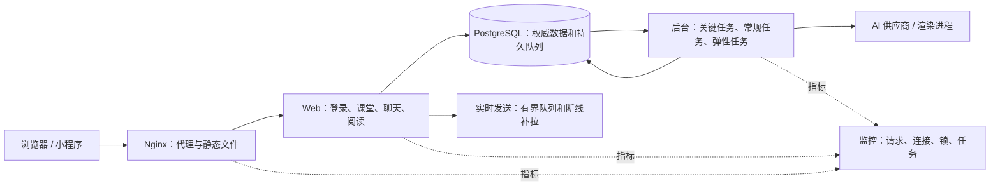

# LanShare 课堂高峰故障复盘与 200 人混合并发改造设计

2026-11-05（北京时间）｜设计稿｜源码基线 `dev` / `9a01d8d9`，线上 `20261105-002015-e255c29a2c2a`。

后续实施与验证状态见 [实施记录](platform-capacity-implementation-2026-11-05.md)；本文保留调查时证据和原验收目标。

**先修进度死锁、行为写入线程退出和错误退登，随后降低首屏与实时流量的放大，再用正式构建做容量验收。** 目前已经查到线上故障，尚不能证明 200 人达标。本文阶段只读调查、隔离复现；未修改业务代码、线上配置或业务数据。

## 1. 线上证据与归因边界

| 时间 / 范围 | 已核实证据 | 判断 |
| --- | --- | --- |
| 10:00–12:00 | Nginx 有 1,073 次 499、15 次 503、1 次 504。499 涉及课堂 118、消息摘要 99、行为上报 79、作业页面 78、首页 73，以及社交等路由；观察到单秒完成日志最多 203 条 | 499 表示客户端先断开，包含主动离开；不能逐条等同故障或用每秒完成数推算同时在线。跨路由同时出现，且有服务端慢请求佐证 |
| 10:51:26–10:52:23 | PG 日志有 15 次锁等待超时、4 次死锁；4 次死锁双方的 SQL 都写 `learning_stage_status`。应用首页、修为概况记录同表死锁 | 已确认课堂高峰的一条主要数据库故障链。11 点后仍有 499，不能把两小时内全部慢请求归给这 4 次死锁 |
| 10:52:22 | `behavior-write` 线程在 `RELEASE SAVEPOINT` 遇到 `InFailedSqlTransaction` 后退出；约 12:44 健康摘要仍显示 `worker_stopped`、4,488 批排队。总队列 4,605 中其余 117 属定时任务 | 这批事件未得到该线程处理。全局健康端点仍返回 `ok`，无法反映模块故障。队列驻内存，重启会丢弃尚未落库的批次；没有安全恢复路径前不把重启当作清理方案 |
| 10:59 | 应用日志出现连接池超时，Nginx 10:59:47 等上游响应头超时 | 峰时出现数据库连接等待和应用长尾。约 12:43 快照 2 vCPU / 3,659 MiB，无容器重启或 OOM；池上限 12、当时无等待。低谷快照不能回证峰时资源充足 |
| 应用计时 | 进程记录课堂最大约 60.9 秒、作业草稿约 58.9 秒、行为批次约 51.6 秒、消息摘要约 48.8 秒；课堂近期样本 P95 约 36.8 秒 | 应用指标保留每路由有限样本，最大值是进程累计；计到响应头附近，不含完整下载、浏览器绘制、Nginx 等待和所有已取消请求。以上不当作严格两小时分位数 |
| 退登 | 在隔离数据库，用真实会话流程对学生身份查询注入一次 `DatabaseBusyError`，随后数据库恢复：原有效会话被删除，返回 401，Cookie 被清除。另用实际前端模块复现延迟 401 触发跳转且请求 Promise 不结算 | 错误退登链已经复现；线上没有关联原页面、鉴权原因与跳转的请求 ID，不能确认每位学生是否走了这一链，或把所有 401、303 计为误退登 |

凌晨 00 点发布窗口的 502/504 与上午课堂故障分开统计。996 条失败是当时各类任务失败存量，包括邮件和 AI 批改历史记录，不能当作当天新增或当前在途。只读查询确认当前没有 `pg_stat_statements`；事故时的逐秒 CPU、事件循环延迟、连接持有时间、每请求锁等待尚缺，不能仅凭后验快照决定扩容规格。

## 2. P0：修复已经证实的故障

### 2.1 进度查询只读，投影更新有唯一入口

- 当前：首页 [`dashboard_service.py:2612`](../classroom_app/services/dashboard_service.py#L2612)、修为接口 [`learning.py:167`](../classroom_app/routers/learning.py#L167)、学生 JSON 登录 [`ui_parts/common.py:505`](../classroom_app/routers/ui_parts/common.py#L505) 会构建全局修为概况。查本人之后又计算全班排行；排行对缺失、过期快照触发回算，回算先写各阶段，再写得分事件和快照。两个学生同时打开，各自先锁自己、再为排行写对方；定时批处理按另一顺序在较长事务内回算。参见 [`learning_progress_service.py:1541`](../classroom_app/services/learning_progress_service.py#L1541)、[回算](../classroom_app/services/learning_progress_service.py#L1676)、[排行](../classroom_app/services/learning_progress_service.py#L2808)。登录页面和登录态共享徽记还可能各发一次完整概况。
- 首页、课堂首屏、徽记、概况和排行全部只读已提交快照。存在旧快照时展示原值和更新时间；首次缺失显示“正在生成”；排行榜按课堂、模型版本和快照时间批读，缺失单列为待计算，不补零、不误排序。登录下发会话后再加载个人轻摘要；完整排行只在主动展开时请求。显式发起试炼、认证、授证、提交或批改仍在写事务中核验当前业务事实，不把旧展示快照当授权或得分依据。
- 沿用 PostgreSQL 和现有任务服务，以 `(class_offering_id, student_id)` 合并脏标记，增加单调版本。每个键只允许一个投影写者；按固定键顺序取得所需锁，计算不持长锁，发布结果时校验版本，发现新事件保留新版本待算。阶段、得分事件、快照按可重放的单位提交；唯一事件标识防重复加分。后台由最老脏记录和时间预算控制每批大小，峰前预热活跃班，历史回填错峰。验证旧模型迁移、迟到事件、批改更正和合班口径；删除所有读时补算入口前，先验证后台追得上峰值变更。

### 2.2 行为事件队列可恢复，并区分接收与落库

- [`behavior_tracking_service.py:133`](../classroom_app/services/behavior_tracking_service.py#L133) 没有线程批次异常保护；外层只捕获 SQLite 异常。内层写入有宽泛的异常捕获，PG 语句失败后事务可能仍处于失败状态。线上直接证实最终异常在释放保存点处；先前使事务进入失败状态的那条语句仍需用注入复现钉住。
- 同一 PostgreSQL 事务内，任何需继续的局部失败都必须回滚到真实保存点；不可恢复则回滚全批并交还未提交工作。对明确可重试的锁冲突、短暂断连、连接池满，分类型做有限重试和随机退避；连接丢失且提交结果未知时按事件 ID 去重核对。缩短批次事务，把日志与投影更新解耦，事件依原业务口径持久化，按人/课堂/窗口只合并脏标记。未证明等价前不丢弃贡献活跃天数、次数或在线时长的事件。
- 增加 worker 心跳、最后成功时间、队列最老年龄、失败和真正持久化计数，停止或过满时暂停接收，返回可重试结果。短期先阻止“死线程继续收”；正式方案使用可重放的有界持久入口承接计分行为，`202` 仅表示已持久接收，提交/投票/考试仍有自己的业务回执。对当前 4,488 批，先确认进程内是否存在安全排空路径及影响口径；现有实现无重启恢复保证，不能承诺补齐，不以伪造事件补账。客户端单在途、幂等 ID、离线保留、随机退避，避免失败后约 300ms 循环重试。

### 2.3 繁忙不改变登录状态

- [`dependencies.py:656`](../classroom_app/dependencies.py#L656) 将查身份异常折叠成“无账号”，走会话和记住设备撤销；[`app.py:567`](../classroom_app/app.py#L567) 的 403 处理可能转 401 并清 Cookie；[`auth.js:38`](../static/js/auth.js#L38) 据此跳转并留下 pending。建立唯一语义：确定缺失、过期、替换、撤销才是认证失败；已有身份无资源权限为 403；数据库不可用、查验/续登超时为 503 + `Retry-After`，不删除会话或设备、不清 Cookie。确证权限前拒绝操作，不以旧权限绕过校验。
- 统一 SSR、老 JS、React、记住登录和 WebSocket 对暂时故障的处理；同一请求复用认证结论。前端业务请求有截止时间、可取消、必定结算；后台角标等非主流程不得抢走当前页面。确认登录失效时只提示/导航一次，保留安全的站内返回路径，并保存尚未提交的草稿。避免并发旧 401 清掉新登录 Cookie；管理员强制撤销仍走权威版本。写操作超时先查回执或沿用原幂等键，禁止盲目重发。
- 登录数据库连接不跨密码哈希和渲染；CPU 校验并发有界，提交会话前重核账号状态和凭据版本，保留账号保护和审计。校园同出口压测同时验证同 IP 的正常学生不会被整体拦截，也不放松单账号暴力尝试防护。

## 3. P1：给课堂流量留资源，减少重复工作

| 领域 | 设计与边界 |
| --- | --- |
| Web 与数据库 | 优先改课堂互动、材料、预览、健康检查等在 `async def` 中执行同步 SQL/文件操作的热点。把完整数据库工作单元移到有界线程或同步路由，释放连接后再等网络、渲染、WS 广播。保留单 Web 进程起步；数据库池、同步线程、排队上限是联动参数。为交卷/签到/课堂/登录预留容量；限制非必要轮询、冷预览、报表等入口的并发和等待。按角色给连接命名，逐项预算 Web + AI + 调度 + 邮件等连接总量，保留维护余量。隔离实验已验证 WS 会计入 Uvicorn 的连接限额；200 人同时开课堂和社交可能先占约 400 条连接，需为 HTTP、SSE、多标签保留余量。限制从同规格压测求得，不能把 PG 的 50 或 Uvicorn 配置的 512 解释成人数。 |
| 课堂互动和实时 | [`chat_handler.py:918`](../classroom_app/services/chat_handler.py#L918) 每次入房向全体发名册和别名状态；200 人集中入房时，光累计名册投递就约 2 万份。加入者只取一份快照，其他人接收版本化增量或合并更新；每 socket 独立有界发送和超时，慢端断线后按游标补拉。投票变化用提交后的公共版本通知合并更新，个人作答和排名独立查询，避免全班同一时间重拉全快照。消息、投票、签到等先提交再广播，状态版本不倒退；重连随机化，保留匿名别名、课程和会话隔离。 |
| 私信、群聊、通知 | 保留 10-30 已上线的群消息去重和通知批处理。继续把会话/未读逐条查改为按用户批量聚合，成员名册按需分页，保留免打扰、拉黑、已读与成员权限。共享铃铛首轮合并、抖动、单在途、只在可见状态轮询、错误退避；可用时用现有实时事件通知增量、保留低频兜底。200 个活跃页面每 15 秒拉一次就约 13.3 次/秒，尚未计切回页面和多标签。 |
| 材料和下载 | [`materials_parts/learning.py:1063`](../classroom_app/routers/materials_parts/learning.py#L1063) 批量查授权后仍逐目录解析；[`exports.py:426`](../classroom_app/routers/materials_parts/exports.py#L426) HTML 每个子资源会重复做权限与路径解析。按发布版本和材料版本缓存目录入口、路径索引、内容指纹；授权与撤回校验独立，私有结果按正确范围缓存，继续隔离 HTML iframe。重复文件 I/O、冷渲染移出请求循环；优先复用现有授权后交给 Nginx 私有内部位置传输，须验证禁止外部直达、范围/路径穿越、ETag/Range 和撤回即时性。渲染有独立槽位、缓存和等待提示。 |
| 首页、博客 | 将首屏所需、进度/次要模块和搜索分开；只读摘要按用户及业务版本，使用游标和批查询。博客同热点帖子浏览计数从阅读事务分离，按已有访客口径去重后异步聚合；评论、附件信息按需加载。用合成 PG `EXPLAIN (ANALYZE, BUFFERS)` 验证排序和过滤索引；不凭猜测全库加索引。 |
| AI、散修、定时任务 | 沿用现有持久任务表和 `SKIP LOCKED`，按“教学期限相关：提醒、交卷后批改的保底通道”“常规：进度刷新、常规批改”“弹性：散修主动行为、周报、爬虫、批量导出”拆认领预算。只认领空闲槽能执行的任务；每任务独立租约、心跳、可重放的结果提交和有界重试；超时/429 按供应商熔断和退避。为低优先级设最低服务份额和最老年龄门槛。任务接收后可见排队、执行、完成、失败和恢复；教学写入不等供应商。给后台容器独立 CPU/内存/连接上限和 I/O 预算，高峰减少启动量，空闲时追积压。先分清 117 条待处理是到期还是未来计划，996 条历史失败按类型核对，禁止一键重放。 |

负载优先级：保登录、考务提交/草稿、签到投票、消息持久化及当前材料访问；先合并角标轮询和非关键推送，再延后可重算的报表、推荐、主动活动及冷缓存生成。界面复用 LQ Status/Alert/Spinner，超时可见、已输入内容不清除；保留原生表单、IME、焦点和 409 草稿。若涉及共享模块，更新模块使用记录和设计说明，执行 `npm run inventory:lq-modules`，用正式构建更新全平台源码审计和实页验证。

## 4. P1 并行：观测、健康检查与发布

1. **入口和应用统一请求 ID。** Nginx 生成可信 ID，记录规范化路由、响应码、`request_time`、上游连接/响应头/响应时长、字节；应用分开记录鉴权、线程排队、连接获取/持有、SQL/锁、模板和文件阶段。会话原因仅标记缺失/过期/撤销/被替换/暂不可验证。日志不含 Cookie、文件授权令牌、查询串、学生姓名或消息正文，未匹配路由归固定桶。采样详情、聚合全量计数；应用按路由模板和窗口输出直方图，而非累积 P95 相加。
2. **健康职责分离。** [`app.py:404`](../classroom_app/app.py#L404) 当前同步访问邮件、任务表并扫描预览缓存。容器存活探针只测事件循环能否应答；就绪用独立小预算 DB 检查或短期快照，健康诊断异步更新并标时效；后台线程退出单独告警，不能导致教学入口全部下线。保留部署流程需要的版本和数据库字段。私有监控采集事件循环延迟、Nginx 499/502/503/504、PG 锁等待和临时文件、资源压力、队列深度/最老年龄/失败增量、WS 重连和慢客户端。
3. **发布降低干扰。** 现流程会在同一宿主机构建并重建容器，再重启 Nginx。先安排课外窗口，用正式产物、备份和健康门禁；迁移用现有 PostgreSQL 原生流程，优先兼容旧版的增量字段。逐步把运行时迁移搬到独立一次性门禁，应用只验 schema；必要时异机构建镜像、旧静态资源继续可用。新旧实例并行需先验证内存、会话、WS 和任务锁语义，不能在当前小机器上直接做双实例全量切换。保留已知良好镜像和独立开关；回滚应用/配置不回滚已提交学生数据或盲删队列。

## 5. P2：容量决定与横向扩展条件

- 先在与线上同规格的 2 vCPU / 约 4 GiB 合成环境跑原版和候选版。同规格通过门禁，可继续单 Web 进程并观测；若优化后 CPU 长期饱和、内存余量不足、swap 或 I/O 压力明显，以 **4 vCPU / 8 GiB** 作为下一档试验规格，或将重渲染/AI/爬虫迁到独立宿主机。若瓶颈在 PG 锁或查询，先修事务和索引；单纯加连接池或代理超时只会扩大积压。规格是实验候选，非容量承诺。
- [`main.py:63`](../main.py#L63) 限制单 worker 有实际原因：课堂/社交连接、在线、别名状态在进程内，登录会话快照和保持登录锁也部分在进程内。先修复会话版本/撤销跨进程可见、并发续登用数据库 CAS，房间事件用提交后 outbox + 有序游标补拉，连接和在线状态用带 TTL 的共享协调，定时任务用数据库租约；随后验证双 Web 实例、任一实例退出和 WS 跨实例交互。可先复用 PG 的持久事实和通知唤醒；如测到共享在线状态或即时扇出是瓶颈再引入 Redis，消息、成绩、会话权威不依赖易失发布订阅。粘性会话不替代一致性和断线恢复。

## 6. 容量验收与实施门禁

现有 [`full_stack_load_test.py:29`](../tools/full_stack_load_test.py#L29) 的 `classroom-200` 默认是 200 个账户、50 个同时运行的流程，使用 SQLite 副本；不能验收生产 PostgreSQL + Nginx 的 200 人混合并发。复用场景与断言，另建全合成数据的正式镜像、Nginx、PG、调度和 AI 测试栈；负载发生器独立运行，明确拒绝生产域名、数据路径和连接串。生成代表性历史学期、群成员/私聊数、材料包深度、热点博客、待处理任务和脏快照，公布种子及场景实际发出的 RPS、在途请求、长连接和回执数。

P0 回归单列：在合成 PG 中同步触发同班两人首页/修为概况和后台刷新，检查这些读入口对阶段、得分事件、快照三表零写入，新版脏标记不被后台覆盖；在行为保存点和提交处注入 SQL 异常，检查线程继续可用且失败事件状态真实；让身份查询一次失败再恢复，检查 503 前后会话及设备无变化，另测真正撤销和迟到旧响应。浏览器端检查超时、断网、权限不足、真失效和草稿恢复的状态与焦点。

| 场景 | 通过要求（候选目标，基线后冻结） |
| --- | --- |
| 200 同时活跃 60 分钟 | 示例：80 人上课互动、40 人聊天、40 人阅读材料、25 人浏览博客、15 人登录/切页，加入真实导航扇出、长连接和小部分草稿/上传；教师流量另加。后台同时运行散修、批改、到期提醒、投影刷新和弹性任务。持续 200 个身份有动作，用开放式请求节奏记录排队和取消，不能靠变慢的发生器掩盖拥堵 |
| 集中峰值 | 同一模拟校园出口，30 秒内启动 200 个登录；随后分别做 200 人集中进房/断线重连、同材料多资源、投票签到、同一群发言和作业草稿/提交。50→100→200→250–300 梯度记录余量；超出容量要可控退避且可恢复，不判超目标场景全部业务必须成功 |
| 延迟和可靠性 | Nginx 侧普通核心 API P95 ≤ 500ms、P99 ≤ 1.5s；主要页面 TTFB P95 ≤ 1s，成功登录 P95 ≤ 2s，签到/投票/消息/草稿确认 P95 ≤ 1s，消息提交到健康客户端可见 P95 ≤ 1s。主流程 5xx/429/非主动取消超时合计 < 0.5%，按领域单列，错误退登、重复提交/加分、越权、已确认关键写入丢失均为 0。浏览器另测 390px 和桌面首屏可交互，材料传输、冷预览、AI 完成时长分开，不能混入 API P95 |
| 后台公平性与恢复 | 固定合成任务速率和 AI 耗时分布，正常供应商下到期提醒启动 P95 ≤ 30s，修为投影更新 P95 ≤ 2 分钟；压测峰值结束后 10 分钟内，积压回到基线或证明剩余都是未来计划。注入池耗尽、锁超时、线程崩溃、AI 429/超时、单慢端、重连、代理异常和多标签旧响应，验证可重放、无错误退登、无重复批改、前台不受持续阻塞。发布判定同时检查 per-core CPU、内存余量、池等待、事件循环延迟和任务最老年龄 |

实施顺序：**第一批**用独立小改动修身份错误分类、行为队列和进度读写分离，逐项回归并做 200 人峰值复测；**第二批**完成有界资源、首屏和实时减量、后台任务分道及 60 分钟整栈验收；**第三批**根据容量数据确定是否升级规格或拆 Web/后台。每批输出上线前基线、合成结果、回滚开关和差异；获得部署授权后才安排线上窗口，观察一个真实课堂高峰，再分别报告线上核验和 Git 推送结果。
