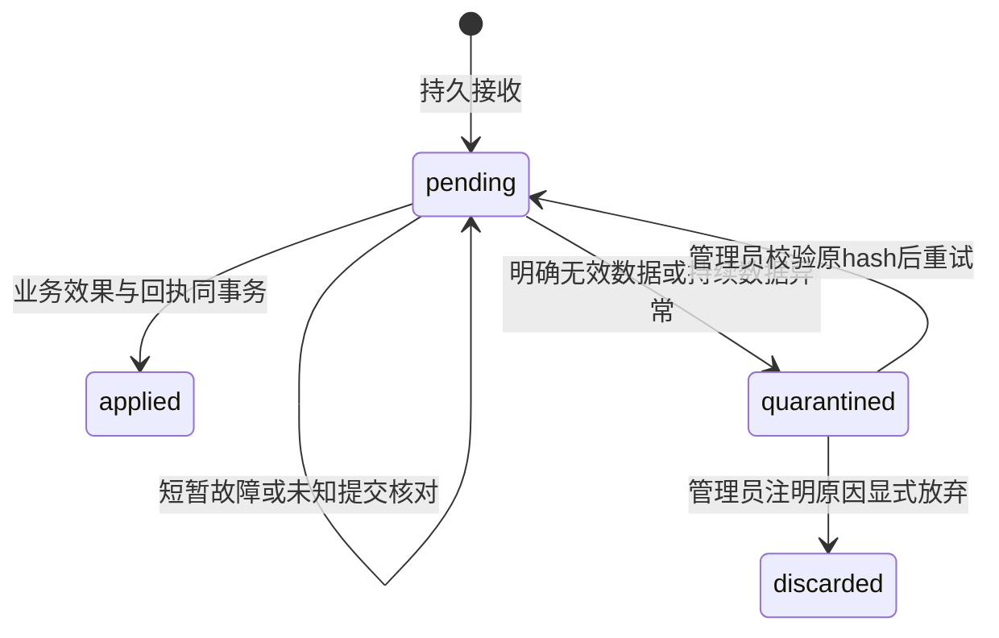

# 课堂高峰承载改进与验证记录

2026-11-05｜分支 `codex/platform-capacity-20261105`｜实施基线 `9a01d8d9`。

候选20在正式Linux镜像通过185项专项和9项实际功能门禁，并完成200人一小时混合压测。开场突发延迟和后段HTTP排队导致容量门禁失败。候选19的网络启动失败和排空证据均保留。全量后端v9为5869项中5566通过、303跳过、0失败。WSL 3.0.3安装后受当前权限限制，实际使用VMware Ubuntu隔离环境。原设计见[设计稿](platform-capacity-design-2026-11-05.md)。

## 当前候选的验收状态

| 范围 | 当前已观察结果 |
| --- | --- |
| 候选20 | 2486文件，源码指纹 `2bc49d08a33aeb1a3b038d91cd96b02cc67f57548c0a3a1b813f0194d411b398`；正式镜像 `sha256:cb3d32a56805416619ca590c1d82281ee58f6edb9e599254b88f0d18762047e0`。相对19仅隔离测试工具一文件变化，业务代码和16个联测文件逐字节相同。 |
| 全量后端v9 | 5869项，5566通过、303跳过、0失败，595.501秒；日志 `.codex-temp/platform-capacity-backend-final-v9.log`。 |
| 正式Linux镜像专项 | 候选20实际185通过、0跳过、0失败、14.349秒；绑定本候选镜像、源码和测试包。18／19的各185通过为独立历史记录。 |
| PostgreSQL组件复验 | 实际通过：完整结构在另一连接持业务锁时，普通／启动检查分别约5.7／3.3ms，各1条catalog查询、0 DDL。仅nonce临时结构内实测缺列／索引补齐、回滚／提交与原行／约束／序列保留；临时结构删除且public／fixture／源码hash不变。知识查询的真实42P01隔离与同名外层SAVEPOINT也通过。未把原生测试的跳过项改称通过。 |
| 全角色功能闭环 | 候选20实际9项全部通过，原周期10次自主动作、0失败，20人私信43.36秒闭合；实际SMTP450／60秒重试、150秒续发及原配额均保留。两个动态Controller与原固定Agent／Mailer同网并存，PG和网络ID不变，临时进程正常退出。 |
| 原生PG白板并发 | 候选19独立执行原5项，5通过／0跳过／0失败，实际最多6连接；body0.969秒、cleanup0.397秒。私有schema清理、public／fixture／源码不变。第一次包装器权限错误保留；不改写v9的303跳过。 |
| 200人一小时混合压力 | 候选20于北京时间07:19:19.844开始，运行ID `dfe6570b0a9c4266bb5821bbb8e462cb`。实际200登录、400条WS全就绪（7.353秒），均无提前断开。原始结果`failed`，144,001个计划动作、4,207个跳过，197,678个前台及68,694个ambient HTTP响应，均无请求故障或异常。登录P95 2353.90ms、开场课堂快照1406.26ms，后段广泛排队使全时段常规课堂快照P95达到10241.40ms。真实爬虫在负载期完成去重。 |
| 终态数据初核 | 停机前真实PG确认440封两类邮件均已提交为sent，200份投影均为最新版本，待处理和隔离行为批次均为0，Agent、AI、散修收件箱和爬虫无未收尾工作。负载窗内实际增加34次散修自主动作、40份课堂画像。退出与完整报告另核。 |
| 上线与Git | 用户已授权推送与部署。旧线上进程有4,595批驻内存行为记录，待保全后才能执行替换旧进程的步骤。所有压力及功能测试均使用隔离合成数据。 |

## 已实施的业务闭环

| 问题 | 最终实现与保留的合同 |
| --- | --- |
| 数据库繁忙被当作身份消失 | 身份查验的短暂数据库错误返回 503 / Retry-After，保留会话及记住设备；确定失效才返回认证错误，无资源权限仍是 403。请求内复用已查身份，不能用旧权限绕过当前业务检查。 |
| 登录占用数据库连接等待密码计算 | 学生、教师及原生表单保留；短事务读取候选，独立有界密码池计算，再以账号锁重新核验状态、密码和重置标记，原子写登录审计和会话。未降低密码哈希强度。 |
| 撤销与迟到续登相互覆盖 | 会话缓存采用身份版本校验；撤销期间禁止迟到回填，冷读也不能回填旧版本。普通登录、记住登录和注销共用账号授权锁；会话与设备凭据撤销在同一事务。失效 access 下也按有效本设备凭据的精确会话号处理，不注销别的设备。退出失败显示“退出尚未完成”，不伪报成功。 |
| 延迟响应使页面跳回登录并一直等待 | fetch/XHR 始终结算；403/503不导航。真正失效使用共享 Toast，由用户点击安全站内登录动作打开新页，保留原页面草稿、IME与焦点，不自动重放提交。 |
| 首页与排行触发进度写入互锁 | 展示只读最近已提交投影。缺失显示生成中，过期保留旧分数和时间，不能把未知当零分。脏版本和计算版本 CAS、单键非阻塞锁和保存点保护发布；阶段、得分事件和投影一起提交或回滚。认证、授证、试炼等业务仍核验当前事实。 |
| 投影刷新任务失败后不再运行 | 只恢复指定的系统投影周期任务；失败冷却60秒后重新赋予一轮重试预算，保留错误诊断。运行中的 claim 和人工取消不改，其他历史失败任务不重放；运行期维护独立于任务租约续租。 |
| 行为线程退出后仍继续接收 | 202之前先持久化回执；固定批次键和原内容指纹去重，保存点失败正确回滚。入账效果和 applied 回执同事务；提交结果未知通过原键核对，不重复计分。线程有监督、心跳、最老年龄、真实确认数及有界容量。 |
| 异常行为数据阻塞整个账号 | 新批次先校验确定无法入账的字段；历史已接收坏批进入明确隔离态，保留原内容/hash，不假记入账，后续正常批可继续。连接、锁、未知提交和程序/schema错误不会被自动放弃。管理员只能按完整范围、原hash和处理原因显式重试或放弃，保留审计。 |
| 行为与删除/合班冲突 | pending 和 quarantined 都阻止删除或合班。入场与父实体删除采用相容的数据库锁；applied / 明确 discarded 回执保留不可变原始范围与指纹，业务删除时退休个人内容，不能重新计分。 |
| 群消息响应等待所有接收端 | 持久提交后只把事件入有界发送队列；健康客户端不被慢端拖住。每socket单写者、hello首位、消息/control FIFO；内部调用仍保持真正发送完成计数的原合同。 |
| 200人同时上线把聊天推送队列挤满 | 在线状态按身份合并最新入队值，独立最多256项；聊天/control仍为32帧，两者连同在途数据共用256KiB总上限。发送与关键帧排队期限有界，慢端明确断开后重新鉴权和补拉。 |
| 聊天重连跨过未读消息 | HTTP游标只推进已完整取得的窗口，不以WS最大消息号代替；固定补拉水位、有界分页与历史入口，重查近期撤回/附件状态。旧会话迟到结果不能覆盖新会话，同步完成前不推进已读。 |
| 课堂投票阻塞事件循环和并发写入 | GET使用同步路由；写入完整数据库单元在线程池提交后再广播。不同学生共享父记录锁并行，同学生按投票/账号串行；关闭、改选项、分配及删除持父记录写锁。可选通知失败用保存点隔离，重复票数、限次修改和权限规则保留。 |
| 课堂集中进房重复广播名册 | 100ms合并名册/别名快照，保留原线协议、匿名身份和逐人加入通知。单socket发送有截止时间，建立失败会清除注册。 |
| 材料目录与子资源重复解析 | 使用单请求预取的材料/祖先索引，重复节点只序列化一次。仍分别验证课堂发布范围、最近授权祖先、根与路径及资源权限；撤回即时检查，HTML隔离、ETag及原有阅读/下载合同保留。未加跨请求权限缓存。 |
| 角标重复轮询与故障重试风暴 | legacy/React复用单在途、完成后计时、随机抖动、8秒截止、隐藏暂停、指数退避和Retry-After。交接时允许极晚React接管的一次短暂读取重叠，不宣称跨owner绝对零重叠。 |
| 健康检查自己制造负载 | live不访问数据库/磁盘，ready检查独立诊断快照新鲜度；重诊断由单个收集器更新。旧health字段保留，明确 degraded/年龄/错误/隔离批数，队列故障不能伪装正常。 |
| 正常连接归还产生大量回滚告警 | 显式close先结束未提交事务；坏连接关闭并由原池补充，双重归还被阻止。提交语义不改，取消原本由池执行的重复正常告警路径。 |

行为回执状态流：

隔离态继续计入入口总容量，不自动清理或丢弃。安全重试仅限7天窗口内且没有更晚入账或活动事实；存在倒序风险时明确拒绝，保留原始数据供专门补偿处理，不改变原计分公式。applied/discarded回执保留至少10天，覆盖客户端7天的固定编号重试窗口。客户端beacon只作为发送尝试，不能冒充已确认；永久失败保留原批并暂停，服务端提供可检查的失败回执。

## 资源预算与明确边界

保持单Web进程。课堂/社交连接、在线状态和别名仍有进程内状态，不能直接增加worker数量。Uvicorn连接门槛由512调整为1024，为约400条长连接和HTTP峰值留空间；这不等于1024个用户，也不取消其他资源上限。

| 项目 | 预算 |
| --- | --- |
| Web默认同步线程 / 数据库连接 | 32 / 12 |
| 密码校验专用工作线程 | 4 |
| 其余容器的默认数据库池 | 每进程4；六个主要角色合计默认32，PG上限50保留维护余量 |
| 调度 | 期限、常规、弹性三个单槽；空槽才认领，独立租约、claim fencing、老任务公平性与停止排空 |
| 后台竞争 | Compose按角色命名连接，给Web和PG较高CPU权重；CPU shares是竞争权重，不是硬隔离或容量承诺 |
| 代理 | 普通HTTP保持上游keepalive，WS保留Upgrade；日志关联request ID及上游计时，敏感grant路径脱敏 |

本轮没有引入Redis、横向Web实例、跨请求私有材料缓存、Nginx私有文件内转或新的消息协议。没有关闭散修、批改、聊天、阅读或定时任务。实际AI供应商耗时、PDF冷渲染吞吐、上传/交卷的联合压力和Linux正式镜像仍须分别验收；受控AI等待不等于真实模型吞吐。

## 候选B：投影短批与运行期维护

A轮记录到投影批次与前台长尾在时间上重叠，尚不能仅凭相关性认定因果。B将周期投影改为短批，保留业务计分和原子发布规则，用独立的相同负载对照验证取舍。

| 系统周期任务参数 | B默认值与合同 |
| --- | --- |
| 脏投影刷新 | 每批最多检查25个键，总软预算0.75秒；旧持久任务payload中的100仍受当前系统上限约束，显式更小的值继续有效。 |
| 首次／旧模型发现 | 独立最多25个键、0.1秒软预算，发现配额不随刷新上限按四分之一缩小；发现最多使用总预算的四分之一，保留最老dirty键的刷新机会。 |
| 计划间隔／空轮询 | 完成后计划间隔3秒，worker默认poll为5秒；实际启动周期还包含轮询、本批耗时和其他normal任务，不能按每三秒运行计算吞吐。 |
| 手工调用 | 原有默认100个键、3秒预算及四分之一发现配额保持；只有显式使用新关键字参数的调用采用独立发现配额。 |
| 运行期维护 | 使用`advance_pending=False`，不提前健康pending的`run_at`，不重置backoff、`updated_at`和排队年龄；running、cancelled及其认领不动。启动时保留旧定时任务提前安排，failed仍仅按指定任务和60秒冷却CAS恢复。 |

预算在键之间检查，已经开始的SQL和原子发布会完成，不能靠取消线程或拆开事务实现硬截止。最早`dirty_at`、版本CAS、保存点整组回滚、每键短事务、旧值展示、三lane及现有aging均保持。任意长normal任务、高优先级无限积压或持续数据库故障不能由这些参数变成两分钟硬保证；最终对照还须检查最老dirty年龄、实际发布尾延迟及其他normal任务的等待。

配置来源已收口：这六项参数统一使用已有`env_file: ./docker.env`和代码默认值，不通过scheduler的Compose `environment`另作插值，避免当前部署流程中覆盖`docker.env`、与app取值不同。移除原固定poll20的覆盖，worker代码默认poll改为5，显式配置20仍有效。实际`docker.env`未修改；配置变更需要按现有流程重建相关容器，单纯重启旧容器不会替换其环境变量。较大批次恢复组合为刷新100／3秒、计划间隔20秒、发现25／0.5秒、poll20；不恢复运行期隐式提前健康任务的行为。参数边界与恢复要求见[配置恢复说明](platform-capacity-projection-policy-2026-11-05.md)。

B的合成后台helper也修正观测边界：发布函数返回只暂存事件，owner提交成功后重新读取可见`calculated_version`覆盖待观测版本，才记录较晚的持久事实观测时间，覆盖外层SAVEPOINT撤销后仍提交其他工作的情形。回滚、关闭、未知提交均不能伪记确认；观测失败单列，不能把已经提交的业务改成重试，最终另查每人的dirty与版本事实。A的原事件早于owner提交，原日志保留，不事后改称提交确认时间。helper连接角色在首次应用导入前明确为`lanshare-scheduler`，池上限4，与生产角色诊断名称对齐。

## 最终闭环补充：凭据签发与调度取消

B首轮全后端通过后，继续交错复核发现了设密／改密签发窗口和调度认领取消窗口。修复后重新运行专项及最终v4全量，首轮通过记录保留，后续改动使用自己的最终验收结果。

认证补充共涉及6个产品文件，包含新增共享`classroom_app/services/self_password_change_service.py`；学生表单和profile JSON自改密共用该服务。首次／重置设密把凭据更新、登录审计和session创建放在原事务内，提交后才按generation保护发布已经形成的token／缓存，不在提交后另建session，从而与管理员撤销保持明确先后关系。

自改密先短读账号，在不持有数据库连接时，将旧密码校验及新密码哈希交给4线程CPU池；随后在actor授权锁内重新核验当前状态、重置标志、密码hash与`password_updated_at`及授权本请求的会话。Web必须匹配当前canonical session；MP保持独立opaque会话，在同事务对精确目标session使用只读`FOR SHARE`核验owner、revoked、expiry及binding，不创建Web会话或滑动续期。全部remember设备凭据撤销和依据锁内本机证据重发设备凭据在同一事务完成，不能用事务外旧设备快照恢复已撤销授权。

记住登录中间件续期后，同步替换传给路由的入站access与remember两个cookie，使路由看到同一轮session／设备证据；出站尊重路由已经设置或清除的`Set-Cookie`，不以中间件更早的结果覆盖。传输层仍有边界：更晚到达的HTTP响应可能把已经失效的cookie留在浏览器，但该cookie不能恢复服务端授权；本轮不承诺消除网络响应乱序。

调度侧将claim→handler→finalizer作为完整owned工作观察。停止或多次取消只打断调用者等待，已开始的真实认领线程、处理器和结果写入仍排空，期间维持lease及原claim条件写入，再向外传播取消，停止后不继续认领下一项。未知claim／提交结果保留诊断并交给既有stale接管，不能假记安全归还pending；结果落库仍受原owner条件保护，不能覆盖管理员cancelled或他人的新claim。三lane、优先级／aging及任务业务语义保持不变。

## 验证记录

最终结果补充于本节；中断的测试和测量问题保留，不能只选成功结果。

- 正式前端资产图：`e862ca4339cf144673b533d00694f3852b4398b315d457a71da5a49034463d69`，541文件，约13.63MB。最新构建、类型检查、模块台账和LQ门禁见最终验证摘要。
- 正式浏览器：登录恢复4项与聊天19项通过；覆盖桌面/移动视口、草稿/焦点与断线补拉。它们不代表全平台所有页面或真实后端故障全部由浏览器实跑。
- 前端单元：94文件、780项通过。
- 较早候选后端全量：运行5,654项，5,357项通过、297项显式跳过，无失败；后续握手诊断工具另有20项专项通过。测试入口硬禁真实PostgreSQL；原生PG验证另用专属合成集群。
- B第一轮后端全量：运行5,682项，5,385项通过、297项显式跳过、0失败，耗时506.223秒；日志为本地工件`.codex-temp/platform-capacity-backend-candidate-b-final.log`。
- 最终v4后端全量：纳入新增认证14项及调度取消10项后，运行5,706项，5,409项通过、297项显式跳过、0失败，耗时498.277秒；日志为本地工件`.codex-temp/platform-capacity-backend-final-v4.log`。
- 最终组件台账、源码审计、模块一致性、LQ lint与类型检查均完成：40模块、18页、349消费者文件；源码扫描588作者文件、209模板、5,674候选，其中4,845 pending、829 unknown。LQ lint为0阻塞、3,674警告、15例外。线程池参数间接渲染的设密页有1个静态映射缺口，另有7个动态个人中心入口，均在Nov5审计报告明确记录；不以扫描状态代替逐页浏览器验收。日志为本地工件`.codex-temp/lq-final-*.log`。
- 课堂投票：本轮原生200人取得200个对应回执，数据库恰有200份选票，重复提交不增票，关闭后新票及非成员拒绝均通过；首投P95约1.96秒，重复提交P95约4.66秒，未达到原延迟目标。修复前3个member-detail连接读取错误没有在复测中出现；旧探针keepalive5秒与生产30秒不一致，不能将修正配置后的成功全归于业务代码。
- 材料定向探针：200文件夹展示由800次SQL降为2次；20个显式HTML资源由40次降为20次。仅为该合成结构的定向比较。
- 原生备份恢复v2：322表全内容/列定义/约束与251序列恢复一致，保留6,814条回执；旧进度版本列及回执CHECK升级后，所有旧字段/hash/events保留，两次独立启动幂等。未验证上传文件恢复。
- 初始推送修复前，200个社交握手仅62个hello就绪，队列发生溢出；在线状态独立合并后，真实200人/400长连接全部就绪。另有200socket×200身份的门闩测试，保留hello与关键消息优先且不溢出。
- Windows临时Nginx最初使用select时记录52个连接异常；改poll后单进程发生器通过建连。四个接收进程更密集建连时又出现拒绝，扩大本地监听队列仍未解决。后来应用直连的400条瞬间建连也复现TCP拒绝；该轮198条就绪、22条观测到拒绝后主动取消剩余连接，不能以22/400计算完整失败率。显式限制为4×8个并发握手后，400条常驻连接全部建立（不重试、不限制常驻数量）；这是分开的峰值条件，不能将瞬间建连失败改记通过，也不能据此宣称Linux代理达标。
- 第一轮计划一小时的直连联合负载，约11分钟、最后完整检查点26,406个动作、200身份/400连接、40动作/秒，没有记录请求错误或提前断线。因发现三处恢复正确性缺口主动中断，明确不计最终一小时通过；原检查点和中断原因保留。

### A完整一小时与B的预检、中断及诊断记录

A轮`900b4d5c`完整运行一小时，记录275,057个测量请求，400条常驻连接全部完成，未记录HTTP、WS、隔离队列或ambient错误；核心API延迟仍超过原500ms门禁，因此结论是运行稳定、延迟SLO失败，不能记为容量验收通过。B随后完成下列预检、中断与诊断轮；这些记录全部保留，最终完整小时另列于下一节，不能用首次投影生成或短时成功替代。

| B轮次 | 实际结果与证据边界 |
| --- | --- |
| 300秒预检 `513bb5da` | 12,001个开放节奏动作、5,955个ambient请求，400条WS均就绪且正常退出；未记录业务/ambient/WS故障，未跳过动作，4个接收进程全部正常收尾。正式结果仍为延迟失败：登录P95为5.010秒、集中HTTP突发2.448秒，业务API全程P95约0.79–1.16秒；不能只选中段较快窗口。 |
| 预检持久事实 | 706个业务行为批和999个心跳批全部applied；200份进度dirty为0、版本一致，pending/Q为0。116个有限后台任务完成，13组提醒无目标收件人遗漏；600次dirty标记全部观测到持久发布，发布P95为37.535秒，提醒启动P95为10.769秒。受控等待不是实际AI批改，散修handler明确返回disabled，不能计作散修AI容量。 |
| 首次完整时长尝试 `96a4a428` | 计划3600秒；约三分钟后发生TCP连接错误，主动优雅中断，请求期及收尾共359.55秒，14,043个动作、零跳过。保留2,907个主流程ConnectError事件及1,063个ambient连接错误；前30条仅为样本，不是错误总量。主流程的复合工作流异常不能当作互不重叠的失败HTTP请求数。该轮正式为aborted，不能算一小时通过。 |
| 中断轮持久事实 | 680个已确认业务行为批和956个已确认心跳批全部applied；200份进度版本一致，pending/Q为0。820次dirty标记全部追平，发布P95为44.743秒。后台停止时已执行工作正常排空，剩余合成计划保留为pending，不假记全部完成；下一轮只按旧合成run前缀取消未执行计划。 |
| 带底层诊断的600秒复现 `18482b8e` | 24,001个动作，34,278个HTTP响应及11,942个ambient请求全部完成，完整fault/exception均为0，400条WS就绪且正常收尾。正式结果仍为failed，仅冷登录P95为5.106秒、集中课堂HTTP突发2.318秒超标；普通核心API P95约0.3–0.4秒，后台三个周期P95为0.319–0.383秒。P99及最大值同样保留，不以P95通过替代全部设计门槛。旧TCP故障未复现，没有因此认定原因或宣称修复。 |
| 600秒复现持久事实 | 1,412个业务行为批和1,997个心跳批全部applied；200份进度版本一致，pending/Q为0。270个有限后台任务完成，提醒无目标收件人遗漏，1,440次dirty标记全部追平；发布P95为35.761秒，提醒启动P95为28.835秒。原始报告及资源、后台、数据库证据使用`.codex-temp/capacity-b-diag10-*`前缀。 |

上述轮次均保留Nginx/TLS、单Web、PG、真实调度、200身份、400常驻WS、40开放动作/秒及三个ambient周期；握手显式限制为4×8并发，不限制常驻数。预检后台dirty生产比HTTP请求期早结束约58秒，不能用末段低尾延迟作单一参数因果结论。完整时长尝试为保证覆盖，后台计划3720秒，包含启动余量；中断后停止新dirty生产并排空已接收工作。各轮使用顺序累积的合成历史和不同进程缓存状态，也不构成严格重置数据的A/B实验。

中断轮的已保存异常表明错误位于TCP建立阶段，没有取得HTTP 401/503响应；旧工具未保存底层WinError，不能据此断言根因为应用、Nginx或Windows端口耗尽。故障时监听仍存在，已建立WS保持，应用健康为ok；Nginx错误日志与近20分钟Tcpip系统事件未提供相应原因。停止后6个loopback存活GET均成功，仅说明低负载恢复，不代表并发达标。当前[NGINX官方Windows说明](https://nginx.org/en/docs/windows.html)明确其使用select/poll并处于beta，不能等同Linux容量证据，也不能替代本次具体定因。

本地工件分别使用`.codex-temp/capacity-b-smoke-*`和`.codex-temp/capacity-b-full-attempt1-aborted-*`前缀，保留原报告、检查点、后台事件/计划/状态、资源budget与原始采样、独立数据库事实。资源采样仅用同PID的CPU差分，区分私有提交与working set，不叠加PG共享working set；没有4GiB内存硬限制。后续定向复现增加完整错误Counter和有界结构化cause/errno/winerror，不改负载、重试、时序或SLO，不在诊断中记录凭据、查询串和正文。

诊断补充新增8项离线用例并复跑既有ambient/drain 10项，共18项通过；覆盖AnyIO式ExceptionGroup内的原生错误码、超过30条后计数保持完整、隐私与链长度界限、早退登录和HTTP 200后内容校验失败。旧`statuses`中字符串表示工作流异常事件，与整数HTTP状态同时保留；新增`http_response_count`只数整数状态，不能把二者求和称为独立HTTP响应。下述完整小时保持这些工具和全部763个后端文件冻结，600秒诊断与完整小时之间未重启应用。

### B完整一小时：稳定运行，开场延迟门禁仍失败

完整B轮为`f8b17e2b07c242599169351f37b44f56`，请求计划3600秒，含收尾实际3601.16秒。144,001个开放节奏动作、203,655个前景HTTP响应及71,761个ambient响应全部完成，共275,416个测量HTTP响应；未跳过动作，完整fault／exception计数均为0。业务行为8,471次和ambient心跳11,984次均取得202，其余测量响应均为200。计数仅涵盖发生器登记的业务、登录、集中突发与ambient请求，不包含所有入口流量或故意触发403的权限负例，也不把一个复合动作当作一个HTTP请求。

200个账号在开场同时登录；400条WS由4个接收进程按每进程最多8个在途握手建立，不重试，常驻数量不受此限制，全部应用就绪耗时6.915秒。既有设计的30秒到达窗没有由本轮实际复现，仍按实际200人同时发起保留2秒登录门禁失败；应用也未在前一轮600秒诊断后重启，不能称为全新进程的冷启动实验。开场登录P95为4,785.51ms，集中课堂HTTP突发P95为2,239.93ms；正式报告因此仍是`failed`。其余前景流程P95为197.12–487.09ms，三个ambient周期P95为244.36–305.30ms，不裁去开场或长尾请求来取得这些结果。

以下均为原始完整小时的发生器端HTTP耗时，单位ms；不是Nginx TTFB、页面LCP或浏览器渲染时间。保留B的P99和最大值，可见P95下降后仍存在数秒个别长尾。

| 流程 | A P95 | B P95 | B P99 | B最大值 |
| --- | ---: | ---: | ---: | ---: |
| 登录 | 5940.16 | 4785.51 | 4879.33 | 4887.94 |
| 集中课堂HTTP突发 | 2373.21 | 2239.93 | 2311.32 | 2338.50 |
| 材料列表 | 634.74 | 297.11 | 587.08 | 4280.71 |
| Dashboard页面 | 736.48 | 440.33 | 651.54 | 4579.66 |
| 进度 | 582.53 | 276.48 | 525.80 | 4023.47 |
| 消息摘要 | 609.99 | 277.35 | 532.53 | 4691.35 |
| 会话列表 | 548.72 | 274.90 | 535.60 | 4382.65 |
| 课堂页面 | 766.34 | 487.09 | 739.87 | 6397.24 |
| 博客摘要 | 524.36 | 230.56 | 482.49 | 5399.24 |
| 课堂互动读取 | 532.77 | 235.20 | 488.86 | 5023.47 |
| 行为接收 | 690.77 | 285.27 | 545.20 | 4584.01 |
| 群消息发送 | 712.00 | 319.97 | 599.29 | 4402.51 |
| 群消息同nonce重试 | 724.98 | 322.37 | 615.32 | 4987.48 |
| 私信发送 | 697.91 | 303.89 | 588.27 | 5102.37 |
| 私信同nonce重试 | 726.65 | 303.65 | 583.39 | 5321.57 |
| 博客流 | 597.33 | 256.03 | 530.48 | 5806.68 |
| 群历史读取 | 458.94 | 209.73 | 408.55 | 6276.91 |
| 博客页面 | 626.00 | 288.29 | 571.72 | 5701.78 |
| 群详情 | 658.11 | 302.62 | 557.09 | 5728.33 |
| 私信历史读取 | 438.32 | 197.12 | 402.42 | 3148.56 |
| 博文读取 | 622.96 | 270.60 | 549.25 | 5780.28 |
| 材料内容 | 708.88 | 282.95 | 564.10 | 6466.83 |
| 私信已读 | 517.96 | 207.53 | 432.14 | 3792.93 |
| 群已读 | 519.92 | 210.93 | 425.75 | 3815.85 |
| 材料预览 | 602.87 | 262.29 | 515.37 | 3693.93 |
| ambient角标 | 714.34 | 272.39 | 524.94 | 7462.42 |
| ambient博客摘要 | 617.11 | 244.36 | 506.35 | 4775.54 |
| ambient行为心跳 | 793.29 | 305.30 | 604.38 | 5534.27 |

一小时内没有观测到WS提前关闭或推送failed／discarded／overflow／expired；结束后writers、writer tasks、排队帧、字节和closing全部归零，行为排空0.76秒，ambient全部在途请求排空0.007秒。最终健康快照为ok。独立持久事实报告逐条确认8,471个业务行为批和11,984个心跳批全部applied，200份投影dirty为0且`dirty_version = calculated_version`，全入口pending／quarantined为0；这与仅取得202或累计内存计数不同。持久事实子检查通过不能覆盖整体延迟失败结论。

后台独立run为`020a70ed4ae44d1c8a3dd7d6fc91cb39`，计划3720秒，为HTTP稳态3600秒预留启动覆盖，随后停止新工作并排空；最终状态在13:43:53 UTC为stopped。1,370个有限任务全部done，包括1,243个受控供应商等待、124个待办提醒和3个作业提醒；127组提醒检查无合成目标收件人遗漏。7,410次dirty标记全部观测到owner提交且可见版本追平，发布延迟P95为37.062秒、最大42.349秒；127个期限任务启动延迟P95为4.852秒、最大13.619秒。无未确认标记、handler失败或发布观测错误。系统散修周期项仍为pending，handler记录为disabled，不能将受控等待或该项计作真实散修／AI批改容量；也不能把后台3720秒计划与HTTP3600秒当成完全相同的统计窗口。

A/B均为完整一小时、200身份、40开放动作/秒、400常驻WS，ambient角标15秒／博客60秒／心跳60秒；同为单Web、线程池32、Web PG池12、连接门槛1024、backlog2048、keepalive30和WS ping20，显式握手限制均为4×8。早期keepalive5秒的课堂探针和400条瞬间无界握手失败是另列证据，不混入这组比较。A/B有9个后端文件不同：投影／调度3个文件及认证相关6个文件（含新增共享改密服务）；合成库历史依次累积，缓存与任务阶段未重置。B发布测量又增加提交后可见版本查询，而A的原发布事件早于owner提交。因此表中较低P95是本次顺序对照的观察结果，不能单独归因于某个参数，也不能直接用A/B发布延迟分布推导纯性能收益。

B的资源原始文件覆盖675个约5秒间隔的离散样本，12:41:40.756–13:41:48.808 UTC，首个样本比HTTP run开始晚3.301秒；此窗口不包含后台最后排空阶段。全部观察到的进程亲和性为`mask=3`，必需父进程无缺失。同PID相邻采样CPU差分合计约1.385核，约占两逻辑核预算69.2%（App0.775、PG0.338、Nginx0.199、后台0.073）；进程生灭可能漏计，平均值也不能排除短时饱和。

| 进程角色 | 首样本私有提交 MiB | 末样本私有提交 MiB | 本窗口峰值 MiB |
| --- | ---: | ---: | ---: |
| App | 1244.68 | 1130.07 | 1416.34 |
| PostgreSQL进程组 | 263.80 | 289.00 | 337.23 |
| Nginx进程组 | 17.41 | 33.65 | 35.31 |
| 后台worker | 755.71 | 759.70 | 759.70 |

App的1,416.34MiB峰值出现在开场第24.743秒（12:42:02.198 UTC），随后回落。以下按run开始时间分段，统计每个离散样本的私有提交值；末段包含到第60分11秒的收尾样本，分位数不是持续时间加权值。

| App观察区间 | 样本数 | 最小 MiB | 中位 MiB | P95 MiB | 最大 MiB |
| --- | ---: | ---: | ---: | ---: | ---: |
| 0–15分钟 | 168 | 1115.57 | 1129.71 | 1140.63 | 1416.34 |
| 15–30分钟 | 168 | 1111.27 | 1127.94 | 1132.91 | 1149.15 |
| 30–45分钟 | 169 | 1115.25 | 1127.86 | 1133.53 | 1137.64 |
| 45分钟–末样本 | 170 | 1109.35 | 1128.74 | 1137.41 | 1153.52 |

本窗口后段没有呈现持续单调上升，不能据此声明“无内存泄漏”，也未查明开场峰值成因；离散采样可能漏掉更短峰值。A的599个资源样本为1,137.64→1,158.27MiB、观察峰值1,193.02MiB，但A首样本晚于run开始439.13秒，缺少最初7分19秒，不能把该峰值与B覆盖开场的峰值直接作同窗比较。

这里是Windows私有提交，不是Linux RSS或整机物理内存；不同角色的峰值不一定同时发生。PG working set含共享页，保持逐PID数据，不相加冒充实际内存。没有4GiB硬限制，不能由本轮推导2vCPU／4GiB云主机已验收；后续Linux验收需要实际施加4GiB限制后重新测量。

本轮原始报告、检查点、后台计划／事件／停止状态、持久事实、资源budget／采样、server SHA／配置和release核验全部封存于`.codex-temp/capacity-b-full-attempt2-*`。冻结的763个后端SHA与进程启动记录一致，1,567个release文件未变，指纹为`eca92e7db7a51d589a838fd23f191ca88ef10d942c1146ae252b97021aee3868`。离线对照与资源摘要为`.codex-temp/capacity-a-b-full-attempt2-comparison.json`及`.codex-temp/capacity-b-full-attempt2-resource-read-summary.json`，仅从封存文件读取，未再次发HTTP或连接数据库。

600秒诊断和此完整小时均未复现前次TCP ConnectError，故没有新的底层errno／winerror可用于定因；前次中断和无界建连失败仍保留，不能改记为问题已修复。此轮也未模拟所有可见群聊客户端在每条新消息后400ms尾沿debounce自动提交已读，只包含写者的显式已读；40可见群读者补充验证仍待执行，更不代表200个真实浏览器同时渲染。用户已授权安装WSL用于Linux正式验收准备；本节记录时Linux正式镜像／代理／资源限制验收尚未开始，Windows结果不替代该阶段。

### B相关测试与原生首次200键

B的投影短批与观测改进当时新增21项测试：投影策略／维护13项，以及提交观测8项，后者覆盖成功提交、回滚／关闭、未知提交、外层SAVEPOINT撤销、观测读取和事件写入失败。去除重复执行后，该组相关定向用例共141项通过：

| 定向范围 | 不重复用例数 |
| --- | ---: |
| cultivation系列，含新增策略／维护 | 52 |
| 后台投影测量，含新增提交观测 | 11 |
| scheduler，含租约、取消、认领隔离和失败恢复 | 14 |
| 进度快照／破境试炼 | 26 |
| PostgreSQL schema适配与schema计划 | 31 |
| 后台管理权限与运行健康快照 | 7 |
| 合计 | 141 |

这些用例通过`tools/test_backend.py`在隔离SQLite／适配器环境运行，硬禁真实PG；schema适配用例不是原生数据库容量实测，也不替代最终全后端结果。B范围、逐文件SHA及定向验证汇总保存在本地工件`.codex-temp/projection-b-draft/applied-manifest.json`。

另在专属原生PG集群中，将完整合成库只读导出并恢复到随机、带所有权标记的独立克隆。保留原学生和历史投影／事件，仅在克隆新增合成班并通过真实成员关联连接一个既有offering，新增200个学生，严格断言恰好200个缺失投影键。首轮使用原班时因涉及多个offering而触发范围断言，未进入计时验收且克隆已清理；修正合成班范围后重跑，没有过滤发现查询或放宽120秒期限。

首次200次状态读取执行600条SQL、零写入，分数和进度全为未知值，状态为building。随后使用真实`_build_learning_metrics`、注册handler及poll5调度worker，无metrics或时钟mock：8批均发现、检查并刷新25人，合计200人，失败0；批次p50为0.468秒，最大0.510秒；最后一人提交并核对可见版本为44.464秒，fresh读取确认全部ready为44.959秒。最终200行dirty为0，脏版本与计算版本一致；空历史的实际计算分数为0，未在building时伪造零分。实际池上限4，探针运行在高位CPU亲和性集合，未并行运行前台HTTP负载；该结果也不证明软预算对任意慢SQL具有硬上界。

报告位于本地工件`.codex-temp/platform-capacity-b-initial-200-20261105-185047/report.json`，独立克隆已删除，原合成源库业务表未改。该验证仅证明**200个新账号、一个offering、200个投影键的首次生成闭环和本次墙钟结果**，不证明200人全部业务联合达标；多offering须按投影键总量评估。真实AI批改、证书生成及散修供应商调用容量未由本探针验证，受控等待不能替代这些实际调用。

### 最终凭据签发与取消专项

认证专项auth 95项、remember 19项、Agent credential 10项全部通过，auth组包含此次新增14项真实SQLite／ASGI交错用例，覆盖学生原生表单、JSON及MP相关合同。日志分别为本地工件`.codex-temp/auth-credential-issuance-final-auth.log`、`.codex-temp/auth-credential-issuance-final-remember.log`及`.codex-temp/auth-credential-issuance-final-agent.log`；这些隔离交错验证不能冒充原生PG、供应商或全平台容量实测。

调度取消新增10项测试，与既有scheduler 14项、投影策略13项、健康快照5项合计42项通过，覆盖认领已提交但结果尚未返回时stop、真实worker停止、handler和finalizer期间多次cancel、两个独立slot互不覆盖、无claim关闭、未知结果诊断与stale新token接管、内部取消不死循环，以及管理员取消不被排空复活。42项与上文141项有重叠，不相加充当不重复总数。首次200键原生结果取得于后续凭据／取消补充之前，仍保留为该投影候选的定向证据；最终Windows候选的v4全量和上述B完整小时结果另列，整体延迟门禁仍失败，Linux正式验收仍待完成。

Windows原生探针以CPU亲和性限制逻辑CPU，未硬限制内存；与云服务器2vCPU/约4GiB、Linux容器/文件系统和供应商环境不等价。应用直连延迟也不能冒充Nginx侧TTFB。容量报告保留原500ms核心API、1s页面、2s登录门禁；有一项未满足就保留失败结论。

### Linux8诊断后的SQL转换缓存

Linux8的两个稳态采样窗仅作诊断：GIL记录225条中，41条叶帧位于SQL兼容转换。该记录占比不能等同CPU百分比，也不解释全部冷登录长尾。此次只优化`classroom_app/db/postgres.py`中原有纯字符串转换，材料读取及其他改进另行记录；未用此微优化宣称200人联合容量达标。

生产调用方只有适配器`execute`／`executemany`。新增每进程最多512条的exact-SQL LRU，仅原生`str`且长度不超过4096字符时进入；大SQL、其他输入和自定义字符串继续原未缓存路径，转换异常原样传播且不留缓存。参数仍在每次执行时分别绑定，SQL执行次数、结果、权限、连接、行工厂和事务均不缓存、不改变。原qmark、引号、注释、百分号、ILIKE和GROUP_CONCAT转换体经AST核对与原实现一致。并发冷miss可重复做同一纯计算，不产生业务效果。

缓存同时限制条数与键长度。按当前转换最多约两倍字符展开、CPython字符串每字符最多4字节保守估算，512组输入／输出字符载荷不超过24MiB，加少量有界索引／对象开销约25MiB以内／进程；实际ASCII短SQL通常明显更小。超过阈值的动态批量SQL不进入LRU。已查LQ模块记录本，本适配器不属于其中的UI组件或消费者，本次没有模板／DOM／组件API变化，不修改LQ台账。

新增10项隔离测试，验证冷热转换一致、不同参数仍逐次执行绑定、executemany新参数序列、LRU淘汰、4096字符边界／大SQL绕过、自定义字符串原强制转换、异常不缓存、八线程独立范围、精确键和字符展开上限。适配器相关57项、MP认证兼容28项及学生SQL／压力错误／元数据7项共92项通过；均经`tools/test_backend.py`隔离SQLite、禁dotenv和真实PG。日志为`.codex-temp/platform-capacity-sql-cache-{adapter,mp,compat}.log`。这些定向结果不替代后续全量回归。

离线CPU计时从真实热点调用方源码提取5条不含参数值的SQL，Windows Python3.14.3、CPU亲和性`0xFFFF0`，5轮交替旧／新顺序，每臂至少250ms进程CPU后按调用数归一化。未缓存转换CPU中位数68.750微秒／次，完全预热命中为0.0799微秒／次；这里只测字符串转换，不能把约861倍微函数差异写成整站收益。1024条唯一SQL的一次性miss对照两臂均约78.125ms，LRU最终保持512条，未观察到该粗粒度CPU计时下的miss收益。脚本及完整结果保留在`.codex-temp/platform-capacity-sql-cache-benchmark.py`／`.json`；未连接DB、HTTP、VM或供应商。实际缓存命中率、前台P95及全部业务联合压力，仍须由新的Linux正式构建、无插桩200人负载验证。

### 材料完整read工作单元与取消闭环

Linux8稳态采样在主事件循环捕获同步PG等待，集中于材料权限、导航、查看和下载。材料入口原有局部offload未包住整条调用链；现在由薄async入口将数据库连接创建／权限及实时会话检查／路径与文本读取／模板及不可用fallback一起放入同一个有界AnyIO worker，连接在该worker内关闭，不把已打开连接跨线程转交。原有async兼容调用保留；文件Range、ETag/304、HTML包父子权限、撤销后opaque grant失效及返回课堂语义不变，未缓存授权结果。

取消前后worker完成有两种交错：未交付的临时ZIP／AI导出只能由worker或取消方其中之一清理。使用锁交接结果所有权；取消方先提交仅文件清理到既有executor，再shield等待，重复取消不能丢失已接受清理。只处理精确`_cleanup_temp_file` background的临时FileResponse，不运行任意background、不删除源材料。新11项真实隔离SQLite／ASGI／文件测试覆盖线程归属、DB与磁盘阻塞时loop可继续、两种取消先后／重复取消、PDF/Range/304、HTML包及原文件保留。

Nginx `access_log`改为两个server各自指定`lq_timing`，覆盖镜像默认combined日志，避免同一请求记两份及默认格式残留原始grant路径。仅这一份timing格式按规范化路径／固定render-content占位符记录，不保存查询串、cookie、referrer或body；没有宣称应用／错误日志整条链都已脱敏。实际Linux `nginx -t`、单条探针日志与原延迟门槛须另行验证。

### WebSocket上游隔离与发生器有效性

独立最小协议复现与source11真实200人诊断已证实旧HttpToolsProtocol在transport升级后启动30秒keepalive，继而直接关闭课堂WebSocket、无WS closeframe并收到ASGI1006。`nginx.conf`增加独立无keepalive的`lanshare_realtime` upstream，仅`/ws/`使用；普通HTTP32条复用／20秒池期限及所有Upgrade／Cookie／Host／forwarded headers、业务鉴权、单worker和PG预算保留。补齐两个本地Nginx派生工具的双upstream及owned日志路径，真实WindowsNginx语法和15项TLS静态/gzip/304/fallback检查通过；不能代替Linux400WS长时验收。

Linux CPython依赖固定uvloop0.23.0，Windows跳过；Uvicorn0.37 auto实际返回uvloop.Loop，21项Linux隔离用例通过，其中11项材料异步用例逐一确认真实uvloop。该事实不是整站性能提升证明。发生器真实采样表明共享httpcore大池同步分配／过期扫描明显；新增显式16分片，合计400max／200idle及原超时、TLS、200独立登录、400WS、到达率／所有门槛不变，默认1保留旧实现。19项HTTP与10项ambient回归通过，报告明确新harness SHA／预算及队列公平性差异；旧失败不重分类。详见[Linux实验记录](platform-capacity-linux-lab-2026-11-05.md)。

提示语服务还经真实双SQLite连接证实提交前ready/共享cache会导致空池长留或回滚后的幽灵提示。实际包327条；自有事务预热／提交后发布、原supplied-conn事务合同、已知写入commit后驱逐及generation fence正在实施，不通过删除3条候选、配图或学校/院系范围提速。最终源码回归与200人联合结论须另据冻结版本结果更新。

### 最新冻结源码回归

candidate10最终源码（含最后的重复取消清理修订）全量后端v6为5806项：5509通过、297既有跳过、0失败，489.907秒，日志`.codex-temp/platform-capacity-backend-final-v6.log`。使用`tools/test_backend.py`：隔离合成SQLite、禁dotenv、禁止真实PG；Windows PowerShell进程亲和性0xffffc。前一v5为5804项，不能用它冒充最终两项取消补充已验收。

最终LQ模块40／页面适配18／消费者349，模板209／台账230，所有人工字段保留；源码审计588文件／5674候选（4845待验、829未知），不能写成全平台UI认证。LQ检查、类型检查、diff检查通过；lint0阻塞、3674既有warning、15例外。精确命令／SHA见`.codex-temp/final-candidate-readonly-review.md`及`final-candidate-source-audit-results.json`。此前前端780项及23个正式浏览器场景见本报告原记录；此次新改动无模板、DOM、CSS或JS字节变化，Linux仍使用正式构建和发布卷验证。

Linux环境、失败对照、插桩诊断、独立Linux生成器及候选结果见[Linux实验记录](platform-capacity-linux-lab-2026-11-05.md)。baseline9收到的1589批全部入账、200快照clean、160有限任务done，不能抵消其延迟／905cap-skips／1条实时连接断开导致的整体失败；新优化的微函数收益不能预先写成整站容量收益。

### Final15功能失败后的认知查询与散修结构修复

Final15的真实Linux全角色功能轮保持 **Final15_FAILED**。该轮只做功能验证，没有进入capacity阶段或前台混合负载；部分批改、Agent、自然邮件和散修恢复子检查通过，不能覆盖专用邮件、散修活动及爬虫的失败，也不能写成200人联合验收通过。原始结论、源码指纹、容器退出及排空事实保留在`.codex-temp/capacity-final15-functional-summary.json`和对应失败证据包中，没有用后续修复回改旧结果。

真实散修上下文暴露两项独立后端缺陷。平台认知查询把提交归属误写为`submissions.student_id`，现已按权威结构改为`student_pk_id`；旧查询助手直接捕获错误，在PG中可能留下aborted事务，连带后续正常读取失败。现在每项查询、fetch和结果转换都处于固定名的局部SAVEPOINT内，失败尝试回滚并释放本层，保留调用者同名外层SAVEPOINT和业务提交所有权。仅明确可选的公文、Agent历史、日历功能缺表可降级；核心统计、缺列、SQL错误、权限、连接繁忙和未知错误继续报告，不能伪造零统计。清理故障保留原异常，诊断仅记录固定查询标签、阶段、异常类别及SQLSTATE，不记录SQL、参数或画像正文。

另一项是新worker启动时的结构锁反序：运行中的tick先持有action log相关锁，随后读取relationships；新进程即使面对完整结构，仍按旧ensure执行44项`ALTER ... ADD COLUMN IF NOT EXISTS`，可与tick相互等待。`schema_wanderers.py`改为完整结构只执行1条静态catalog检查，正常结果返回0条缺项，不传回全部列元数据，更不运行DDL。检查覆盖14表、246列及18个关联到正确表且valid／ready的索引；原44项增量字段与全部原DDL声明经AST比对保持一致。PG普通业务缺项时明确要求升级，只由中央两处owned startup显式允许补缺；不提交调用者事务、不发布进程级ready。SQLite保留独立内存库及事务内lazy准备，回滚后可重试。真正的旧PG升级仍须暂停业务，迁移advisory锁只协调迁移者，不是在线升级无等待保证，也不自动修复任意历史类型／默认值／约束漂移。

认知修复的44项host定向用例通过，其中13项覆盖实际SQLite事务、权威字段、同名外层SAVEPOINT和经真实适配器传入的类型化PG错误；另含Bridge 8项、workspace 14项和在具备SDK依赖的隔离venv中9项。散修相关544项通过、23项原生PG显式跳过，另外48项数据库启动／隔离夹具／合班回归通过；新增12项真实SQLite跨连接、失败回滚、独立内存库、持业务写事务并发及适配器合同已包含在544项中，不重复相加。另准备3项owned原生PG交错场景，尚未执行。精确SHA与日志见`.codex-temp/platform-knowledge-fix-freeze.json`和`.codex-temp/wanderer-schema-fix-final.json`。这些修复的真实PG catalog执行、锁交错及新Linux联合压力仍待验证；v9全量回归在本段记录时运行中，未预填结果。Final15旧镜像的144项Linux通过不能作为新源码的通过证据。

本次还对Final16的2470个源码文件逐项比对并复核前后SHA：仅上述认知服务、散修schema与中央schema共3个生产文件变化，其他2467个不变。588个UI作者输入与Final16及既有审计的名称／规范化UTF-8 SHA完全一致，1647个前端／模板／静态／构建输入字节不变，3文件的路由与LQ消费者扫描前后均为空。6份生成台账／审计、230个条目的19项人工字段及notes保持不变，因此本次未重写生成物、未重复inventory／typecheck等整组命令。证据为`.codex-temp/post-final16-ui-audit-delta.json`；源码审计仍为pending，不是视觉、功能或容量认证。

## 运维恢复与发布

异常回执检查工具为 `tools/behavior_inbox_recovery.py`，默认只读list；inspect可看指定批次，retry/discard要求完整原hash、课堂、账号、操作者、原因及显式写确认。仅受信任的服务器管理员使用，不增加学生可调用的管理API。先修原因再retry；不能批量把隔离态改成applied，不能静默改原payload或重算成绩。

旧线上故障时驻内存的4,488批行为不在新表中，本轮没有宣称恢复它们，也未重放历史任务。部署前须单独核实当前进程及积压的可恢复性；不能以重启或伪造事件当作补账。

用户已授权Git推送和部署。上线沿用现有流程，先完成原生迁移门禁，再在课外窗口切换。保护`/lanshare/data`，备份数据库与上传文件，保留旧镜像和静态资产。回退应用或配置时保留已提交的学生数据与行为回执。Git和上线核验分别记录。

自动审批拒绝递归删除三个本轮`materials-git-update-test-*`临时目录，提示为`blocked by policy`。随后采用保留全部内容的可逆归档，逐项核实源与目标都在当前工作区后，移到`.codex-temp/platform-capacity-own-git-test-residue/`；没有删除文件，不作为产品变更或交付源码的一部分。其他原有未提交文件保持原位。

### 2026-11-06 05:04的上线前只读核对

仅一次HTTPS健康读取确认旧线上版本仍为`20261105-002015-e255c29a2c2a`，行为worker已停止、驻内存队列4569批（相对最初4488的净增长81），健康顶层仍返回ok。996是历史失败存量，另有124条计划任务，不能当作本轮新增失败。未执行SQL、POST、重启、部署或生产压力测试。原队列没有得到恢复；发布前必须保护真实原批次，不能直接重启、盲目重放或伪造补账。现存旧flush只向已停止worker排barrier，不能当恢复接口。只读证据留在`.codex-temp/capacity-production-readonly-preflight-20261106/`；具体保存路径仍在评估，未对生产内存做抓取或注入。

现有发布脚本的显式writer stop及普通Compose up都可能终止／替换旧app。备份PostgreSQL或一次健康读取为0都不能证明旧内存已保全；先要有同旧容器／进程、原批次完整档案、入口收口和在途处理证据。旧请求没有稳定的原接收时间和批次ID，封存与后续核账必须分开，不能以重放当前日期的事件补旧积分。阻断位置及保全方案见私有审查`.codex-temp/legacy-deploy-blocker-design.md`、`.codex-temp/legacy-behavior-preservation-review.md`；当前仅有审查方案，尚无已验证的生产导出或补账工具。

北京时间08:17:29在同一旧容器内只读复核，行为线程仍已退出，内存队列已增至**4,595批**。旧日志在11月5日10:52:22连续记录了PostgreSQL锁超时、学习进度写入报错、事务已中止和行为线程`InFailedSqlTransaction`退出。旧代码捕获进度异常后没有恢复事务，最终在释放保存点时报错并终止线程。旧线程当时已从队列取出的批次不包含在当前4,595批计数中。新的持久回执、保存点和事务回滚覆盖这条故障链。原进程及驻内存数据须先保全，再执行会替换进程的部署步骤。脱敏证据见`.codex-temp/capacity-production-readonly-preflight-20261106/legacy-worker-20261106-0817.json`。

候选20之后减少了学生课堂快照中的两次查询，成员资格仍实时读取原权限谓词，教师快照和匿名可见规则保持原合同。54项相关回归通过，与候选20对比的五组快照JSON完全一致。空活动的学生快照从5条查询减至3条，有关闭测验的场景从10条减至8条。两组正式镜像的短突发对照单独计入诊断。

仅调用现有本地打包清单函数（未创建发布包、未SSH）实测：当前工作树会选中4018项，其中含5项无关未跟踪文件。已生成排除这5项的4013项审查清单，不能从原脏工作树直接发布。2470个基础验收文件逐一核对无字节变化；现脚本未选中的两个基础文件分别为正式Docker构建会再生成的`static/assets/manifest.json`和根目录中文试卷JSON示例（实际下载接口由`EXAM_JSON_TEMPLATE`生成），真实依赖锁`requirements.lock.txt`已选中。清单审查不是发布包或迁移门禁通过；证据`.codex-temp/capacity-actual-deploy-manifest-review-v2.json`。
