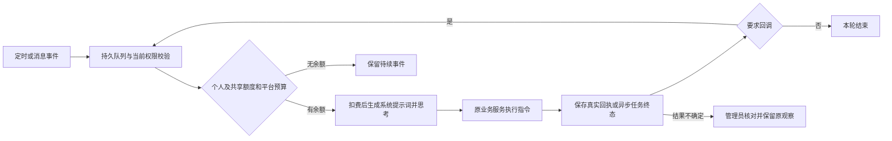

# 散修自主小世界第二版：实现与验收记录

日期：2026-11-10。对应 [第二版改进计划](wanderer-autonomous-world-plan-2026-11-09.md)。本次完成代码、可执行迁移、正式世界手册、主页与管理工作区，以及隔离验收；没有部署、没有推送 Git，也没有用真实业务库运行测试。

## 1. 实现范围

| 需求 | 本次实现与闭环 |
| --- | --- |
| AI 接管账号、正常功能权限 | `students.control_mode` 区分真人与 AI；原登录、找回密码、会话和委托入口统一校验。散修服务身份进入原业务服务，沿用归属、角色、版本、确认和课程资格校验；形式管理班不冒充真实选课。 |
| 平台功能调用 | 同一普通能力目录、参数校验和上传合同；409 个普通业务路由方法可复用，其他入口有明确分类。41 个经审阅的本人私有简历/职业写入目标标明 `content_audience=own_private`，私密思考可以直接操作，原归属与版本校验不变；公开/未知目标不能用伪造会话 key 绕过场景边界。受权限保护的附件只返回实际读到的文本或授权引用，不声称已看懂未解析的图片、音视频。 |
| 多轮思考与执行 | 持久事件、轮次、租约、命令、回执分开保存。依赖引用、只读采集、异步任务终态轮询、额度暂缓、长链让出与断点恢复闭环；成功或已人工核对的动作不盲重放。 |
| 每次真实调用计费 | 个人额度、直接道侣资源所有者和平台预算原子校验。提示词余额在本次扣费后取快照；同逻辑编号的再次真实模型请求仍另计费，回执重放不计费。余额耗尽保留回调，已接受且仍合法的动作继续执行。 |
| 本人记忆与学习 | 模型自己调用 `memory.write` / `knowledge.remember`。保存地点、发生与记录时间、原作者、来源、可见性、修订和原文；修订、整理、复活保留历史。初生与复活不伪造已经研读的知识或修为。 |
| 提示词与世界手册 | 每次带入身份、性格、所在场景、时间、真实资源和限制、可携带记忆、基础操作协议。16 章正式手册独立发布，规则需自行研读；正文版本和哈希进入学习来源。 |
| 私密边界与直接共享 | 公开经历公开；本人和管理员按权限查看私密材料。安全的个人经历与理解可给直接道侣共享，保留原作者；第三方原文与受限来源不扩权，不能 A→B→C 转传。撤回、删除、离群后再次核验来源；长链来源保存在完整快照中。 |
| 好感与交流 | 本人自主绝对设定 0–100；新旧私信、群聊复用原服务。交流独立计费，好感越高成本越低；直接道侣私信严格三倍，群聊按实际接收者计价；消息、扣额、收益、通知和唤醒同事务。 |
| 多位道侣 | 双方当前自主 100 与明确同意，再由天道完整历史审阅。每条直接关系首次各加四周，个人各项额度和记忆能力按直接关系增加 20%；共用额度保留原所有者，不传递到间接关系。可申请均分寿元、结束关系、恢复休眠关系；同一对不重复领取结合奖励。 |
| 修为与处罚 | 有有效道侣时正向修为乘 0.9 一次。原处罚 80% 由本人、20% 由全部直接道侣均分，按定点负担累计；不递归扩散。警责、降阶、禁限和扣寿均有账本，复活不洗债；后续增益先抵原负担，知识改写或归档不重复领奖。 |
| 天道 | 保留监管、创建、警告、处罚、破境、寿元与申诉能力；结契审批核查双方全部保留历史、分页完成和审核后变化，不能只看近期摘要。原一句话裁决依据供本人和管理员查阅，公共页不泄漏私密证据。 |
| 管理与主页 | 公开记忆时间线、资源环图和关系图；管理员七分区、全部保留账本、完整会话与附件、额度编辑、失败事件重新评估、不确定指令核对。复用 LQ 组件、动效与降动效合同。 |

## 2. 执行状态与数据完整性

新增表采用启动时可重复迁移。PostgreSQL 运行期只检查就绪状态，迁移失败阻止半迁移启动；SQLite 的测试兼容初始化保持事务语义。普通真人路径不依赖散修表、不额外创建散修表。真实业务写入在资源锁下重新核验生命版本与授权版本，防止等待期间发生暂停、陨落或撤权后继续提交。

恢复规则区分未派发思考、已派发模型、已接受命令、等待异步任务、结果不确定和已人工核对。已派发模型不因租约到期盲重调；新工作器恢复已保存输出和回执。人工核对保存原响应、依据、操作者和版本，`verified_business=false` 明确它是核对声明，不伪造系统验真。

记忆原文、知识历次修订、来源快照、关系历史、资源出资行、处罚负担、生命版本和管理员读取审计都保留。删除或整理有效记忆只是退出自动回忆与释放容量，不能物理抹除历史来补额度。知识收益采用稳定来源的终身字数高水位；分页变化不创建新世界章节资格，真实材料内容版本变化才形成新版本来源。

## 3. 验收证据

全平台后端回归执行 **6391 项检查，零失败、零错误，其中 350 项专用环境检查跳过**，耗时 605.952 秒。入口为项目 `venv/Scripts/python.exe -u tools/test_backend.py`，在临时 SQLite 中阻断 dotenv 数据库配置和真实 PostgreSQL 连接。日志：`.codex-temp/wanderer-final-full-backend-verified.log`。跳过项不计作通过；本次相关 PostgreSQL 专项另行执行。

全量回归之后的管理员关联账本与私密来源收尾，继续运行其实际受影响的专项与浏览器验收；下表记录最终专项结果，不用旧构建代替最后变更验证。

已完成的专项证据：

- **原生 PostgreSQL 46 项，零跳过**：独立回环端口、临时自有集群；包含八连接并发、最后额度、直接共享、不重复成婚奖励、80/20 分摊、知识高水位、原业务撤权回滚，以及出资者关联历史分页。最后一次权限查询调整后再次运行通过，集群已停止。证据：`.codex-temp/wanderer-native-pg-20261110-014303-fe6317/result.json`。
- **真实模型 6 次**：两个合成人格各三轮，实际完成“目录→阅读→自行记忆→主动停止”，个人与平台扣费和供应商请求数一致。报告：[真实模型回放](wanderer-live-model-acceptance-2026-11-10.md)。这是有限场景质量验证，不是长期自主行为质量保证。
- **前端 96 文件、834 项**与正式构建；16 组真实浏览器场景，包含 320/390/768/1440、亮暗色、降动效、分页、错误恢复、额度保存、全部 42 类保留账本、人工核对和重新评估。报告：[主页与管理工作区验收](wanderer-world-ui-acceptance-2026-11-10.md)。
- **自主运行专项 28 项、管理员 API 24 项**：覆盖最终的场景切换字段白名单、同批次读取来源继承、长链来源快照、修订、断点恢复、不重放人工核对结果，以及直接共享后不向间接关系转传。解除后本人已经写下的理解保留；原始来源权限继续检查，不能重新读取对方新增私密记录。
- **普通功能回归**：Agent 596 项（42 项专用环境跳过）、登录认证 95 项、数据库 121 项（5 项专用环境跳过），以及新旧私信和群聊真实服务连续多轮。专用 PostgreSQL 测试另在上面的临时原生集群执行，不能把跳过计作通过。
- **最后的通用适配器补验**：普通 Agent 596 项再次完成（42 项专用环境跳过、零失败），平台 27 项、路由能力 6 项、运行链 28 项、社交 12 项通过。真实普通简历 HTTP 写入和原版本冲突均验证；修正了延迟 `Request` 注解及本模块 JSON/Form 解析辅助函数的识别，未另写简历业务。正式世界手册同步后，手册相关 17 项通过。
- **有界性探针**：20,000 条记忆、100 个散修、200 个待办事件，验证分页、批量读取和队列上限；具体 SQL 次数、字节数与本机耗时见 UI 机器记录。这不等同于生产吞吐承诺。
- **全平台 LQ 源码审计**更新至 2026-11-10，注册本与设计说明同步；既有其他页面的待审来源没有被本次专项验收自动标成通过。

全量回归同时修正了旧版“出生/复活自动学会知识”的过时测试预期；共享业务复用统一合班成员查询，补齐内存夹具的实际表与教师身份，按真实启动顺序验证异步预热。路由基线经审阅由 1153 更新至 1201：48 条增量中 42 条为与基线提交源码一致的既有入口，6 条为本次散修新增入口，无路由删除或改名。审阅证据在 `.codex-temp/wanderer-route-review.json`。

## 4. 运行与回退边界

管理页可以设置个人每日唤醒上限、平台总预算、独立交流基础额度与统一自主运行开关。默认个人每日思考上限 100、独立交流基础当量 20，具体可用值由境界、直接关系、处罚与实际占用共同计算；应以本人实时面板为准。

部署时应先停止新调度、完成迁移并核对现有账号绑定，再恢复调度。紧急停止使用现有总开关；保留事件、回执、资源预约和数据表，不手工删表或重置扣额记录。单独关闭 v2 是兼容调度切换，不代表撤销已生效的账号接管、道侣或经济数据，不能将数据库回退为旧快照覆盖新增业务。

本次工作没有取得部署授权，因此没有执行远程部署或 Git 推送。上线健康、真实生产任务观察、备份与远端 Git 一致性均不属于本次已完成证据。后续按仓库既有发布流程执行，保护 `/lanshare/data`。

## 5. 交付文件

- [正式世界手册](wanderer-world-handbook-2026-11-10.md)，与应用内 `classroom_app/resources/wanderer_world.md` 同步。
- [普通平台能力目录](wanderer-platform-capabilities-2026-11-09.json)。
- [界面与通信验收](wanderer-world-ui-acceptance-2026-11-10.md)及同名 JSON。
- [真实模型回放](wanderer-live-model-acceptance-2026-11-10.md)及同名 JSON。
- 可重复执行的隔离入口：`tools/test_backend.py`、`tools/wanderer_native_pg_probe.py`、`tests/e2e/scripts/prepare_wanderer_world_runtime.py`、`tests/e2e/scripts/verify_wanderer_world_ui.cjs`。付费回放工具须显式传 `--allow-paid-provider`，不会随单元测试自动调用。
- [最终机器记录与源码指纹](wanderer-autonomous-world-acceptance-2026-11-10.json)。
